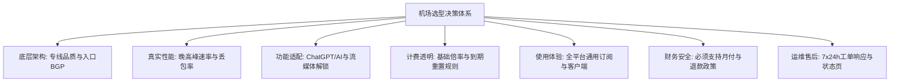

# 机场怎么选？2026 稳定新手机场选型 8 大核心指标与避坑清单

<QuickAnswer>
<strong>核心结论：</strong>挑选机场切忌只看“节点数量”或“便宜年付”。评估一家机场是否靠谱的核心在于 8 项指标：<strong>① 是否采用 BGP/IEPL 专线中转（杜绝公网直连）；② 晚高峰（20-23点）丢包率是否低于 1%；③ 是否支持原生纯净 IP 解锁 ChatGPT 与流媒体；④ 流量倍率是否透明无暗坑；⑤ 协议是否现代化（如 SS/Trojan/Hysteria2）；⑥ 客户端配置是否简单通用；⑦ 是否支持按月付费与试用；⑧ 是否有及时的售后工单支持</strong>。
</QuickAnswer>

## 一、为什么“盲目选机场”容易踩坑？

在网络代理市场中，服务商质量良莠不齐。很多新手在刚入门时，经常被以下营销话术所误导：

- **“全网最便宜，30 元包三年”** → 结果购买两周后频繁大面积超时，最后网站失联“跑路”。
- **“拥有 200+ 全球节点”** → 实际上 180 个节点都是假中转或严重卡顿的冷门公网节点。
- **“绝对稳定、永不封锁”** → 夸大宣传，无任何突发海缆或网络故障的冗余备用方案。

为了帮您在几分钟内看清一家服务商的真实底色，我们梳理出 **“2026 机场科学选型 8 大核心指标”**。

---

## 二、机场选型 8 大核心考核指标

### 1. 底层线路类型（决定稳定性的基石）
- **IEPL / IPLC 跨境物理专线（首选推荐）**：数据在国内入口汇聚后，直接通过物理专线光缆跨境直达海外机房，**完全不经过公网国际出口**，不受防火墙阻断与晚高峰公网拥堵影响，延迟极低且极度稳定。
- **BGP 公网中转（次选）**：采用国内多线 BGP 服务器作为入口转发，性能优于直连，但在特殊网络波动时期可能产生抖动。
- **普通直连 VPS（不推荐作为主力）**：廉价直连服务器，晚高峰丢包率通常高达 30%~70%，体验极差。

### 2. 晚高峰（20:00 - 23:00）真实丢包与速率表现
白天测速跑满几百兆并不代表真实水平。必须考核晚高峰全网用网高峰期的表现：
- **优秀的标准**：晚高峰延迟波动 $\le 10\text{ms}$，丢包率 $< 0.5\%$，YouTube 4K 视频秒开不转圈。
- **劣质的表现**：晚高峰持续缓冲、频繁中断、网页加载超时。

### 3. IP 质量与 AI / 流媒体解锁能力
- 必须具备**原生住宅 IP 或广播纯净商用 IP**，能够全绿解锁 Netflix 非自制剧、Disney+、HBO Max。
- 能够无障碍交互 **ChatGPT (OpenAI)、Claude (Anthropic)、Google Gemini 及 Midjourney**，不频繁弹出 Cloudflare 5 秒盾或人机验证。

### 4. 流量计费倍率是否透明（防暗扣）
- **什么是倍率？** 如果您使用了标有 `2.0x` 的节点，消耗 1GB 实际流量，系统账户将扣除 2GB 配额。
- **合理规范**：主流节点（香港、日本、美国、新加坡）应保持在 `1.0x` 标准倍率；特殊大带宽或极速专线明确标注 `1.5x ~ 2.0x`，禁止出现未标明的暗扣倍率。

<ComparisonTable
  :headers="['节点标示', '倍率系数', '实际消耗 10GB 流量', '适用场景']"
  :rows="[
    ['香港 01 [标准专线]', '1.0x', '扣除 10GB', '日常搜索、网页浏览、日常视频播放'],
    ['日本 02 [流媒体专线]', '1.0x ~ 1.2x', '扣除 10GB ~ 12GB', 'Netflix、YouTube 4K追剧、日常娱乐'],
    ['美国 03 [原生AI专线]', '1.0x ~ 1.5x', '扣除 10GB ~ 15GB', 'ChatGPT、Claude 办公辅助交互'],
    ['冷门特种线路 / 极速节点', '2.0x ~ 3.0x', '扣除 20GB ~ 30GB', '大文件急剧下载 / 特定测试需求']
  ]"
/>

### 5. 协议现代化与多协议兼容
优先选择支持 **Shadowsocks (2022)、Trojan、VLESS-XTLS、Hysteria2、sing-box** 等协议的服务商。现代协议在握手开销、抗丢包加速（基于 UDP 协议的 Hysteria2）及移动网络漫游切换上拥有巨大优势。

### 6. 全平台通用客户端支持
好的机场提供标准且兼容广泛的订阅格式（支持 Clash、Shadowrocket、v2rayN、sing-box、Surge、Loon），并提供详尽的图文新手配置文档与一键导入按钮。

### 7. 计费模式：坚持“支持月付、拒绝超长绑定”
- **黄金准则**：新用户第一单**必须选择月付或季付**！
- 哪怕年付优惠再大，在未连续稳定使用 3 个月以上之前，绝不要轻易年付。正规服务商必然提供灵活的月付套餐与合理的退款政策。

### 8. 售后保障与技术支持响应
- 是否提供**工单系统 (Ticket)** 或在线实时客服？
- 遇到节点异常或订阅解析错误时，客服是否能在 1~2 小时内响应并解决？

---

## 三、小白选型速查表：按预算与需求匹配

  
🟢 轻度需求（学生 / 学术查资料 / 偶尔查文档）

  

    <strong>推荐方案：</strong> 基础专线月付套餐（月流量 50GB ~ 100GB，预算约 10~15 元/月）。 
    <strong>重点关注：</strong> 香港/日本低延迟节点、Google Scholar/GitHub 连通顺畅度。
  

  
🔵 日常主力（程序员 / AI生产力 / 4K高清视频爱好者）

  

    <strong>推荐方案：</strong> 高品质 IEPL BGP 专线套餐（月流量 200GB ~ 500GB，预算约 20~30 元/月）。 
    <strong>重点关注：</strong> 晚高峰 0 丢包、ChatGPT/Claude 纯净原生 IP 解锁、多设备同时在线数。
  

  
🟣 跨境商务 / 重度下载（外贸独立站 / 跨境电商运营）

  

    <strong>推荐方案：</strong> 独享/大带宽企业级专线套餐（月流量 1000GB+，支持团队多并发）。 
    <strong>重点关注：</strong> IP 固定度与信誉、7×24 小时 SLA 运维响应保障。
  

---

## 四、新手常见问题解答 (FAQ)

<FaqAccordion :items="[
  {
    q: '为什么有些机场节点多达上百个，实际用起来却很慢？',
    a: '节点数量不等于可用带宽。很多服务商将一台单核 VPS 伪装成 10 个不同名字的“虚拟节点”，实际上全部共享微薄的公网带宽。选择机场应看重“真专线带宽体量”与“单节点实际测速”，而非单纯追求数字好看。'
  },
  {
    q: '什么是“到期重置”与“自然月重置”？',
    a: '“到期重置”指从您购买当天算起，满 30 天后重置当月流量配额；“自然月重置”则是每月 1 号统一清零重置。购买前需确认套餐的重置规则，避免在月末购买导致流量被过早重置。'
  },
  {
    q: '发现节点连不上时，应该怎么联系机场客服？',
    a: '进入机场用户后台，点击“工单中心 (Support Tickets)”或“提交工单”，详细描述您的客户端类型、报错提示及所连接的具体节点名称，通常正规机场会在 30 分钟至数小时内回复处理。'
  }
]" />

---

## 五、下一步推荐阅读与落地清单

<TopicBridge
  title="查看经过严格实测的稳定新手机场榜单"
  targetLink="/free-airport/recommendations"
  targetText="直达《2026 稳定新手机场推荐清单》"
>
  根据上述 8 项严苛标准，我们对市面上多款服务进行了长达 30 天的晚高峰丢包与速率实测。点击直达实测榜单。
</TopicBridge>

<BrandCard
  brandName="光速云 (Guangshu Cloud)"
  description="完全符合 8 大选型严苛标准：纯血 IEPL BGP 跨境专线，晚高峰 0 丢包，1.0x 标准倍率透明计费，原生解锁 ChatGPT 与 8K 超清流媒体，支持月付且提供无忧售后保障。"
  affLink="https://sahude.gsyvipaff.com/#/?code=keqgvT5Y"
/>
