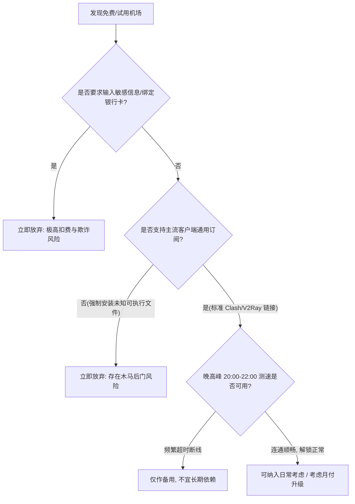

# 2026 免费机场与免费机场代理综合评测与避坑指南

<QuickAnswer>
<strong>核心结论：</strong>“免费机场代理”和免费试用套餐通常适合<strong>低频轻度查阅文本资料、临时应急或测试客户端连通性</strong>。由于公用带宽拥挤、节点频繁被封锁以及缺乏长期运维成本支撑，免费机场代理普遍存在<strong>晚高峰速率低、延迟抖动大、节点存活期短（数小时至数天）及隐私审计风险</strong>。如果您需要用于 ChatGPT/Claude 交互、跨境办公或 4K 高清视频，建议了解高质量专线方案或先通过 <a href="/free-airport/trials">免费机场试用精选</a> 进行实机体验。
</QuickAnswer>

## 一、什么是“免费机场代理”？概念与运行机制全景

在网络代理技术语境中，所谓的“机场”指的是**基于 Shadowsocks、V2Ray (VMess/VLESS)、Trojan、Hysteria2 或 sing-box 协议构建的分布式代理节点订阅服务**。用户通过订阅链接将批量国外节点一键导入至 Clash、v2rayN、Shadowrocket 等客户端中，实现智能分流与网络加速。

市面上的“免费机场代理”主要可以划分为以下三类：

1. **纯公益/开源爬虫分享池**：由网络爱好者或自动化爬虫抓取互联网上公开发布的节点组成的订阅链接。这类节点所有人均可无门槛连接，但存活期极短。
2. **商业机场提供的免费试用套餐**：正规商业服务商为了让新用户验证本地网络与节点兼容性，提供注册赠送少量流量（如 1GB ~ 10GB）或限时试用（如 1 天至 3 天）的体验服务。详见 [2026 免费机场试用精选指南](/free-airport/trials)。
3. **低质广告/引流型免费机场**：以“永久免费”为噱头吸引大量用户注册，但在后台实施严格的数据审计、强行弹窗广告，甚至收集用户明文请求记录进行商业变现。

---

## 二、免费机场代理 vs 试用套餐 vs 专线付费全维度对比

为了让大家建立客观理性的预期，我们从技术和运维角度对不同层级的机场代理进行对比剖析：

<ComparisonTable
  :headers="['评估维度', '公用免费机场代理 / 爬虫节点', '正规机场免费试用套餐', '商业级 IEPL 专线机场']"
  :rows="[
    ['获取成本', '0 元，公开网页抓取', '0 元或 1 元（邮箱注册验证）', '10 ~ 30 元/月（按需选择）'],
    ['节点稳定性', '极低（数小时至 1 天大面积失效）', '较高（试用期内与付费主干同线路）', '极高（SLA 99.9% 专线保障）'],
    ['晚高峰速率', '经常断流、严重限速转圈', '较好（受试用并发限制）', '稳定跑满本地千兆带宽 (500M+)'],
    ['AI / 流媒体解锁', '基本不可用（IP 已被封锁报 1020）', '绝大部分原生支持', '原生独立 IP，稳定秒开 4K/8K'],
    ['隐私与安全性', '存在中间人监听与嗅探风险', '正规商户运营，协议严格加密', '严格无日志策略，内网加密传输'],
    ['售后与工单支持', '无任何人工运维支持', '基础文档支持', '7×24 小时工单与专属客服协助']
  ]"
/>

### 1. 免费机场代理的核心优势与适用场景
- **完全零金钱门槛**：对于预算有限的学生群体或偶尔只需要查阅维基百科、谷歌学术文献的用户，免费资源可以解决燃眉之急。
- **验证客户端环境**：在首次安装配置客户端时，可以使用免费节点测试客户端的 TUN 虚拟网卡、系统代理配置是否生效。相关教程可查看 [Clash 免费节点配置](/free-node/clash) 与 [v2rayN 节点测速](/free-node/v2rayn)。

### 2. 免费机场代理无法回避的技术瓶颈
- **带宽超卖与骨干拥塞**：服务器带宽与跨境专线费用极其高昂。一个千兆公用节点如果涌入上千人同时看视频，人均带宽将跌至几十 KB/s。
- **IP 信誉度低下**：免费节点的公网 IP 地址通常被数万人共用，Google、OpenAI、Cloudflare 会将其判定为高风险代理，导致频繁弹出人机验证（reCAPTCHA）或直接返回 `403 Forbidden` / `Access Denied`。想要了解 AI 解锁请参考 [ChatGPT/AI 专用节点配置](/free-node/ai-nodes)。

---

## 三、免费机场代理存在的安全与隐私隐患

很多初学者容易忽视网络代理底层的安全边界。虽然现代 HTTPS 协议对传输的数据内容进行了端到端加密，但节点服务器运营者仍然能够获知：

1. **您的真实访问目标域名（SNI）**：服务商可以完整记录你在什么时间访问了哪个网站。
2. **未加密明文流量的嗅探**：对于少数仍在使用 HTTP 明文传输的接口，恶意节点运营者可以直接截获传输数据。
3. **DNS 劫持与诱导钓鱼**：恶意搭建的免费节点可能会篡改 DNS 解析结果，将您引导至虚假的登录页面窃取账号密码。

> **安全使用守则**：使用任何来源不明的免费机场代理时，**严禁登录网银、支付工具、重要电子邮箱及输入包含个人敏感隐私的信息**。更多安全分析见 [免费机场安全与风险科普](/free-airport/security-risks)。

---

## 四、如何判断一个免费/试用机场是否值得体验？

如果您打算体验某款机场的试用服务，建议按照以下清单进行核验：

1. **不强制下载未知第三方 .exe / .apk 专属软件**：优先选择提供标准 Clash、sing-box 或通用订阅链接的服务，杜绝被植入恶意后门的风险。
2. **注册信息最小化**：正规服务商通常仅需常用邮箱接收验证码即可，无需实名手机号或绑定支付凭证。
3. **线路透明度**：观察节点列表是否明确标注了直连、公网中转或 BGP/IEPL 专线类型。详见 [机场怎么选 8 项指标指南](/free-airport/how-to-choose)。

---

## 五、新手常见问题解答 (FAQ)

<FaqAccordion :items="[
  {
    q: '免费机场代理真的可以一直永久使用吗？',
    a: '互联网上不存在真正无条件、高性能且永久免费的商业级代理服务。服务器、机房带宽、IP 租用和运维人员均有持续高昂的硬性成本。所谓的永久免费通常要么是短期引流噱头，要么是通过植入广告、售卖流量数据甚至实施网络欺诈来维持。'
  },
  {
    q: '为什么免费节点导入后全部显示 Timeout 超时或 0ms？',
    a: '这是免费节点最常见的现象。原因通常有两个：一是该节点的公网 IP 或端口已经被防火墙阻断；二是节点由于流量耗尽或服务器宕机已被服务商下线。建议更新订阅链接或参阅【节点全部超时排查指南】。'
  },
  {
    q: '用免费节点访问 ChatGPT 提示 Access Denied 怎么办？',
    a: 'OpenAI 对数据中心 IP 和公用代理 IP 有非常严格的封控策略。免费节点的 IP 通常被滥用严重，已被列入 Cloudflare 和 OpenAI 的黑名单。解决办法是更换为具备纯净原生住宅 IP 或高质量专线节点的付费服务。'
  },
  {
    q: '正规商业机场的免费试用通常怎么获取？',
    a: '许多口碑良好的机场会在官网提供 0 元试用套餐或 1 元体验套餐。注册账号后进入用户中心，在购买订阅页面选择“体验套餐”或输入试用兑换码，即可获取几小时到几天的完整专线节点权限。详见【免费机场试用精选指南】。'
  }
]" />

---

## 六、最合理的下一步指南

<TopicBridge
  title="了解更多：免费与付费机场的本质差异"
  targetLink="/free-airport/free-vs-paid"
  targetText="阅读《免费机场 vs 付费机场深度对比》"
>
  如果您希望深入了解专线网络与普通公网中转的技术实现差异，以及为什么长期日常使用建议选择可靠的月付方案，请继续阅读我们的深度对比评测，或直接查阅 <a href="/free-airport/recommendations">2026 稳定新手机场推荐清单</a>。
</TopicBridge>

<BrandCard
  brandName="光速云 (Guangshu Cloud)"
  description="如果您厌倦了免费节点的频繁失效与卡顿，推荐了解光速云自营企业级专线服务。全 BGP 入口，原生流媒体与 AI 极速响应，支持月付且提供完整的工单售后技术支持。"
  affLink="https://sahude.gsyvipaff.com/#/?code=keqgvT5Y"
/>
