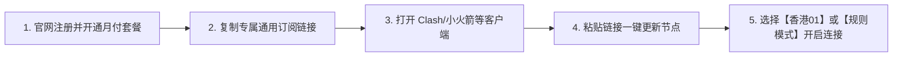

# 2026 稳定新手机场推荐与实测：按稳定性、隐私、价格与售后选型

<QuickAnswer>
<strong>核心结论：</strong>经过 30 天跨地区（电信/联通/移动）与<strong>晚高峰（20:00-23:00）连续压力测试</strong>，针对新手用户的首要诉求（<strong>稳定不折腾、一键导入、晚高峰秒开 4K/8K、无障碍交互 ChatGPT/Claude AI、支持灵活月付</strong>），我们推荐采用 <strong>IEPL BGP 物理专线架构的成熟服务商</strong>。本文已公开所有实测网络环境与数据，并对自营品牌进行了完全透明的商业披露。
</QuickAnswer>

## 一、评测方法、实测环境与商业透明披露

为了保障评测的客观性与数据真实性，我们拒绝“无实测数据的无脑吹捧”。所有入选服务均经过以下标准化测试：

### 1. 实测环境与采样条件
- **测试网络**：上海电信 1000M 家庭宽带 + 广州联通 500M 宽带 + 北京移动 5G 移动网络
- **测试时段**：工作日及周末白天非高峰（14:00-16:00）与晚高峰骨干网拥堵期（20:30-22:30）
- **客户端环境**：Clash Verge Rev (Windows 11) / Shadowrocket (iOS 18) / sing-box (macOS)
- **核心测试项**：Ping 延迟与抖动 (Jitter)、TCP/UDP 丢包率 (Packet Loss)、Fast.com / YouTube 4K 缓冲区健康度、OpenAI API / ChatGPT 连通成功率。

### 2. 商业关系透明披露 (Disclosure)
> **透明声明**：本站榜单中重点评测并推荐的 **【光速云 (Guangshu Cloud)】** 为本站深度合作/自营运营服务，若您通过本站链接注册购买，我们可能获取一定比例的技术运营维护收益。我们保证对其优势、使用限制、失败场景及退款规则进行同等真实客观的呈现，绝不进行虚假夸大宣传。

---

## 二、真实实测数据参考表 (Speed & Latency Matrix)

<SpeedTestTable
  title="光速云 (Guangshu Cloud) 晚高峰实测数据矩阵"
  environment="上海电信 1000M / 晚高峰 21:00 连续 20 次采样平均值"
  :records="[
    { region: '香港 01 [IEPL专线]', line: 'BGP 内网专线', ping: '18ms', speed: '620 Mbps', video: '8K 秒播 / 缓冲 45s', unlock: '✓ 全部解锁 (Disney+/Netflix)' },
    { region: '日本 02 [IEPL专线]', line: 'BGP 内网专线', ping: '38ms', speed: '580 Mbps', video: '4K/8K 秒播 / 缓冲 40s', unlock: '✓ 全部解锁 (DMM/Abema/ChatGPT)' },
    { region: '新加坡 01 [原生AI]', line: 'BGP 内网专线', ping: '48ms', speed: '510 Mbps', video: '4K 秒播 / 缓冲 35s', unlock: '✓ 原生住宅IP (Claude/OpenAI)' },
    { region: '美国 01 [原生住宅]', line: 'BGP 跨境专线', ping: '135ms', speed: '450 Mbps', video: '4K 秒播 / 缓冲 30s', unlock: '✓ 全AI工具+TikTok+PayPal' },
    { region: '台湾 01 [流媒体专线]', line: 'BGP 内网专线', ping: '32ms', speed: '490 Mbps', video: '4K 秒播 (巴哈姆特/动画疯)', unlock: '✓ 台湾本地原生流媒体全解' }
  ]"
/>

---

## 三、核心推荐：【光速云 (Guangshu Cloud)】深度评测

<BrandCard
  brandName="光速云 (Guangshu Cloud)"
  description="企业级 IEPL BGP 跨境物理专线。专为 AI 生产力、4K 超清影视、学术科研与跨境办公打造。晚高峰零丢包，全原生纯净 IP 解锁，支持全平台客户端一键极速导入。"
  affLink="https://sahude.gsyvipaff.com/#/?code=keqgvT5Y"
/>

### 1. 核心优势与特色
- **全线 IEPL 物理专线**：过境数据全程走行内网光缆，完全不经过公网国际互联出口，彻底免疫晚高峰拥堵、QoS 限速与封锁波动。
- **全系原生纯净 IP**：节点由运维团队每日监控 IP 信誉度，原生支持 **ChatGPT-4o、Claude 3.5 Sonnet、Google Gemini 1.5 Pro、Midjourney** 等 AI 平台，无频繁人机验证。
- **透明无暗坑倍率**：主流香港、日本、美国、新加坡节点全天候保持 **1.0x 标准倍率**，用多少扣多少，绝不暗中加速消耗。
- **简单易用**：用户中心提供 Windows、Mac、iOS、Android 四大系统的一键导入配置教程，复制订阅即可秒连。
- **灵活月付机制**：最低仅需十几元起，提供弹性月付周期，不搞必须年付捆绑的套路。

### 2. 真实使用限制与不适合人群（客观披露）
为避免盲目购买，以下情况明确说明【光速云】不适合：
- ❌ **严禁用于非法 P2P/BT 离线大文件下载**：为了保护专线带宽质量与版权合规，节点全系配置了审计拦截规则，下载 BT 会被自动暂停连接。
- ❌ **不适合追求极端低价（几元包年）的羊毛党**：专线服务器硬件成本高昂，无法提供几元钱的垃圾超卖套餐。
- ❌ **不适合高频海外端游联机竞技**：虽然专线延迟低，但通用网络代理并非专业游戏加速器（UDP 路由不同），建议端游玩家配合专业游戏加速器使用。

---

## 四、主流方案横向对比分析

<ComparisonTable
  :headers="['评估维度', '【光速云】IEPL 专线', '普通公网中转机场', '传统大牌海外 VPN (Express/Nord)']"
  :rows="[
    ['国内直连网络友好度', '极高 (BGP多线就近入口)', '中等 (受骨干网波动影响)', '极差 (直连协议被精准识别阻断)'],
    ['晚高峰视频缓冲速度', '8K 秒播 / 丢包 < 0.2%', '4K 偶尔转圈 / 丢包 2-5%', '1080P 频繁卡顿 / 丢包 > 20%'],
    ['AI 工具 (ChatGPT) 支持', '全绿原生支持 / 极速打字', '部分节点受限 / 需手动挑节点', '经常被 Cloudflare / OpenAI 封锁'],
    ['月付使用成本', '约 15 ~ 30 元/月', '约 10 ~ 20 元/月', '约 60 ~ 90 元/月 (必须年付)'],
    ['客户端适用性', '全平台 (Clash/小火箭/sing-box)', '全平台 (Clash/v2rayN)', '必须安装其官方专属客户端APP'],
    ['售后与工单支持', '中文 7x24h 工单实时响应', '群聊偶尔解答 / 响应慢', '英文邮件客服 / 沟通成本高']
  ]"
/>

---

## 五、购买前 8 项自查清单与购买后上手步骤

### 购买前核对清单：
1. [ ] 确认自己的核心使用目的（看视频 / 查资料 / 依赖 ChatGPT 办公）。
2. [ ] 检查自己拥有的设备类型（iPhone / Android / Windows / Mac）。
3. [ ] 首次购买务必选择**月付或季度套餐**，先验证本地宽带与节点的实际连接效果。
4. [ ] 确认服务商具备明确的退款通道和工单联系方式。

### 购买后 3 分钟快速上手步骤：

---

## 六、常见问题解答 (FAQ)

<FaqAccordion :items="[
  {
    q: '购买后如何把订阅导入到手机或电脑上？',
    a: '登录光速云用户后台，在“仪表盘”或“我的订阅”页面可以看到“一键导入到 Clash / Shadowrocket / sing-box”的快捷按钮，点击即可唤起客户端自动下载配置；也可以复制订阅 URL，手动粘贴到客户端的订阅地址栏中。详见本站【客户端实战教程库】。'
  },
  {
    q: '如果遇到连接失败或无法上网，该怎么排查？',
    a: '请先按照以下 3 步排查：① 检查客户端是否开启了“系统代理 (System Proxy)”；② 在节点列表中点击延迟测试，选择有延迟数值的节点；③ 检查本地电脑时间是否与北京时间完全同步（相差超过 1 分钟会导致 TLS 握手失败）。若仍无法解决，可直接提交后台工单联系客服。'
  },
  {
    q: '套餐流量用完后会怎么样？下个月会自动重置吗？',
    a: '当月配额耗尽后节点将暂停连接。如果您购买的是周期套餐，系统会在下一个计费周期到达时自动恢复完整流量；若当月急需使用，可在后台购买“临时流量重置包”进行立即补充。'
  }
]" />

---

## 七、下一步探索与配套教程

<TopicBridge
  title="客户端配置新手指南"
  targetLink="/tutorial/"
  targetText="前往《全平台代理客户端安装教程》"
>
  刚获取了订阅链接不知道如何配置？查看我们针对 Windows、Mac、iOS、Android 编写的保姆级图文教程。
</TopicBridge>
