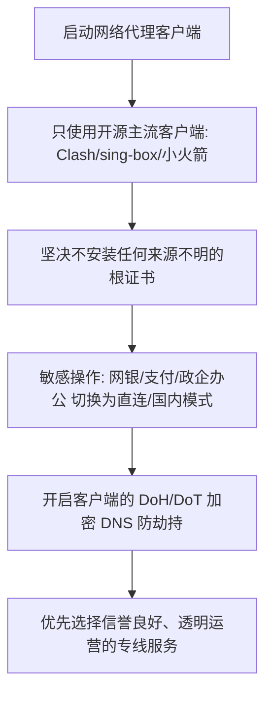

# 免费机场安全吗？防审计、数据泄露与钓鱼风险深度科普

<QuickAnswer>
<strong>核心结论：</strong>免费机场和未知公共节点<strong>存在不可忽视的隐私与安全风险</strong>。虽然全网普及的 HTTPS 加密技术能够防止攻击者直接读取您的账户密码和通信内容，但<strong>恶意节点运营者依然可以通过 SNI 域名嗅探、DNS 劫持、恶意证书注入和流量特征审计，记录您的全部上网行踪甚至实施钓鱼诈骗</strong>。在使用任何免费节点时，切勿用于登录网银、重要个人邮箱或传输机密数据。
</QuickAnswer>

## 一、网络代理的隐私边界：服务商究竟能看到什么？

要科学评估“免费机场是否安全”，我们必须先厘清在网络代理过程中，哪些数据是加密的，哪些数据是暴露在外的：

```text
【您的设备】 ──(代理加密隧道)──> 【代理服务器 (机场)】 ──(公网连接)──> 【目标网站 (如 Google/银行)】
                                      │
                         ┌────────────┴────────────┐
                         ▼                         ▼
                  【服务商能看到的】        【服务商看不到的 (HTTPS)】
                  1. 您访问的域名(SNI)      1. 登录密码与聊天明文
                  2. 访问的具体时间点       2. 传输的具体网页内容
                  3. 产生的网络流量大小     3. 银行支付的安全凭证
                  4. 您本人的真实源IP
```

### 1. 代理服务商【能够】获知的信息
- **您访问的目标域名（SNI 机制）**：当浏览器发起 HTTPS 请求时，在握手阶段需要向服务器发送目标域名（例如 `mail.google.com` 或某特定论坛）。代理服务端可以完整记录您在何时访问了哪些网站。
- **您的真实网络出口 IP**：除非您使用了多重代理跳板，否则机场服务端记录了连接它的真实本地宽带 IP。
- **流量大小与在线时段**：服务商清楚知晓您的网络活跃时间段以及上传/下载的数据体积。

### 2. 代理服务商【无法直接】看到的信息（前提是未安装恶意证书）
- **HTTPS 传输的密文数据**：由于端到端 TLS 加密的存在，第三方无法直接解密网页的具体文章内容、输入框文字或表单信息。
- **密码的明文哈希**：现代正规网站在传输敏感凭据时均采用高强度加密通道。

---

## 二、免费机场与公共节点的四大安全隐患

<div class="grid grid-cols-1 md:grid-cols-2 gap-4 my-6">

<div class="p-5 rounded-xl border border-red-200 dark:border-red-950/60 bg-red-50/50 dark:bg-red-950/20">
  <h3 class="text-base font-bold text-red-800 dark:text-red-300 mb-2 flex items-center gap-2">
    <span>1. DNS 劫持与诱导钓鱼</span>
  </h3>
  <p class="text-xs sm:text-sm text-slate-600 dark:text-slate-300 leading-relaxed">
    恶意节点可以在服务端篡改 DNS 解析，当您尝试访问某官方网址时，将请求解析到黑客搭建的高仿假网站，骗取您的账号密码或验证码。
  </p>
</div>

<div class="p-5 rounded-xl border border-red-200 dark:border-red-950/60 bg-red-50/50 dark:bg-red-950/20">
  <h3 class="text-base font-bold text-red-800 dark:text-red-300 mb-2 flex items-center gap-2">
    <span>2. 强制安装定制客户端与木马</span>
  </h3>
  <p class="text-xs sm:text-sm text-slate-600 dark:text-slate-300 leading-relaxed">
    某些以“永久免费”为诱饵的平台，要求用户必须安装其专门打包的 <code>.exe</code> 或 <code>.apk</code>，暗中植入后台挖矿程序或常驻后门。
  </p>
</div>

<div class="p-5 rounded-xl border border-amber-200 dark:border-amber-950/60 bg-amber-50/50 dark:bg-amber-950/20">
  <h3 class="text-base font-bold text-amber-800 dark:text-amber-300 mb-2 flex items-center gap-2">
    <span>3. 商业广告注入与暗刷流量</span>
  </h3>
  <p class="text-xs sm:text-sm text-slate-600 dark:text-slate-300 leading-relaxed">
    部分免费代理会在用户浏览 HTTP 网页时强行插入浮动广告弹窗，甚至利用用户的闲置连接代理他人进行垃圾邮件发送或刷单。
  </p>
</div>

<div class="p-5 rounded-xl border border-amber-200 dark:border-amber-950/60 bg-amber-50/50 dark:bg-amber-950/20">
  <h3 class="text-base font-bold text-amber-800 dark:text-amber-300 mb-2 flex items-center gap-2">
    <span>4. 用户访问日志被打包倒卖</span>
  </h3>
  <p class="text-xs sm:text-sm text-slate-600 dark:text-slate-300 leading-relaxed">
    “免费往往是最昂贵的”。缺乏资金支撑的免费机场，后台收集的大量用户浏览偏好与社交关联数据，常被作为暗网数据包出售。
  </p>
</div>

</div>

---

## 三、机场所谓的“审计规则 (Audit Rules)”是什么？

很多新手在导入订阅后，会发现某些特定网站无法打开，并在日志中看到 `Audit Rule Matched` 或 `Blocked by Policy`。

### 1. 为什么正规机场普遍设置审计规则？
- **防止节点被滥用与封锁**：BT/PT 离线下载（P2P 协议）会瞬间占满服务器所有上行带宽，并引来版权机构的 DMCA 警告函。
- **防范网络攻击与诈骗**：阻断政治敏感站点、反动诈骗平台及暗网 Tor 节点，保护服务器网络合规运营。

### 2. 恶劣审计 vs 正规安全审计的区别
- **正规机场**：规则透明公开，仅拦截 P2P 下载、Spam 垃圾邮件协议和违法欺诈网站，不记录也不审查用户的普通浏览数据。
- **黑心免费机场**：暗中监听用户的全部 HTTP 请求，定向捕获未加密的认证 Cookie。

---

## 四、安全使用网络代理的 6 大黄金守则



1. **坚持使用官方开源客户端**：仅从 Github 官方 Releases 仓库下载 Clash Verge Rev、v2rayN、sing-box，或从 App Store 下载正版 Shadowrocket。
2. **切勿安装任何提示“必须信任”的未知根证书 (Root CA)**：一旦安装未知证书，恶意中间人将能够完全解密并查看您的所有 HTTPS 流量！
3. **开启加密 DNS (DoH / DoT)**：在 Clash 或客户端中开启 `https://dns.alidns.com/dns-query` 或 Cloudflare DoH，防止本地或出口 DNS 被污染。
4. **重要事务坚持使用官方国内网络**：在进行手机银行转账、公积金查询、政务平台登录或企业内网连接时，请务必关闭代理或使用“绕过大陆”分流规则。

---

## 五、新手常见安全问答 (FAQ)

<FaqAccordion :items="[
  {
    q: '我用免费节点看 YouTube，谷歌账号会被盗吗？',
    a: '通常不会直接导致密码泄露，因为 Google 采用了全站严格的 TLS 加密和双重验证 (2FA)。但如果该节点的 IP 曾经被黑客用于恶意攻击，您的 Google 账号可能会因为在异常高风险 IP 下登录而被临时冻结或强制验证手机号。'
  },
  {
    q: '所谓的“无日志机场 (No-Logs Policy)”是真的吗？',
    a: '在技术层面上，完全 0 日志是难以实现的（系统需要记录最基础的流量消耗以结算套餐配额）。可靠的商户所承诺的“无日志”，是指不对用户的访问目的 URL、数据包内容和 DNS 请求做持久化保存，并在断开连接后立即清除会话内存。'
  },
  {
    q: '如何检测当前节点是否存在 DNS 泄露？',
    a: '您可以访问国际知名的检测网站 dnsleaktest.com 进行 Standard Test。如果测试结果中显示的 DNS 服务器全部为您所连接的代理地区（如香港、日本），说明 DNS 解析正常被代理保护；如果显示了您本地电信/联通的 DNS，则存在 DNS 泄露风险。'
  }
]" />

---

## 六、下一步探索与决策路径

<TopicBridge
  title="如何科学评估一家机场的综合可靠度？"
  targetLink="/free-airport/how-to-choose"
  targetText="阅读《机场选型 8 大指标指南》"
>
  了解了安全边界后，如何挑选既安全合规、又稳定高速的代理服务商？请阅读我们的 8 项选型考核指标。
</TopicBridge>

<BrandCard
  brandName="光速云 (Guangshu Cloud)"
  description="光速云秉持隐私至上与安全合规原则，采用全专线物理隔离网络，不保存用户访问日志，全系节点支持 DoH 加密解析与纯净原生 IP，为您打造安全安心的加速体验。"
  affLink="https://sahude.gsyvipaff.com/#/?code=keqgvT5Y"
/>
