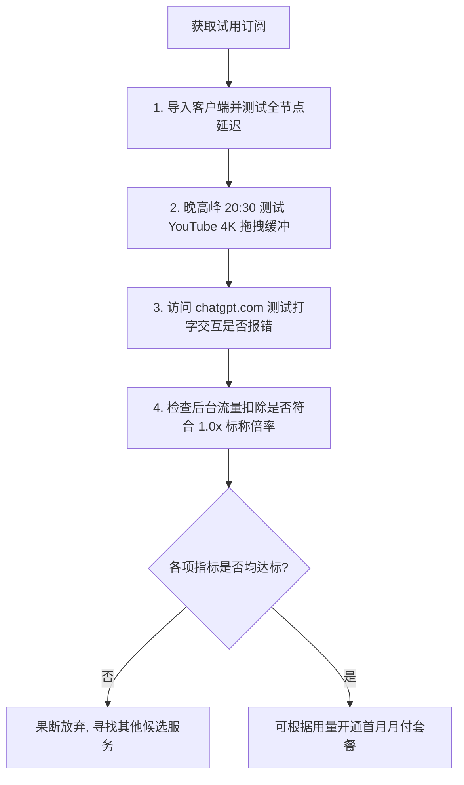

# 2026 支持免费试用的机场精选与体验避坑指南

<QuickAnswer>
<strong>核心结论：</strong>正规商业机场提供的<strong>免费试用（通常为注册赠送 1GB ~ 10GB 流量或 24 小时体验期）</strong>是新手在付款前验证本地网络兼容性、节点延迟及 ChatGPT/流媒体解锁的最佳途径。在体验试用套餐时，<strong>切勿输入真实银行卡号或授权自动扣费</strong>，并重点在<strong>晚高峰（20:00-22:30）</strong>进行 4K 视频与 AI 交互压力测试。
</QuickAnswer>

## 一、为什么正规机场会提供试用？试用有哪些形式？

在购买长期订阅前，许多用户会担心：“买完了在我的网络环境下连不上怎么办？”、“我用的移动宽带会不会被 QoS 限速？”

为了消除用户的顾虑，正规服务商通常提供以下两种体验模式：

1. **0 元无门槛免费试用（Free Trial）**：
   - 用户使用常用邮箱注册账号后，系统自动在后台发放一个体验订阅，内含 1GB ~ 5GB 流量，有效期通常为 12 ~ 48 小时。
   - 目的：让用户核验客户端能否正常下载配置文件、本地网络能否连通。
2. **1 元 / 小额体验套餐（Micro Trial）**：
   - 支付 1 元人民币获取 10GB ~ 20GB 的全专线节点权限，有效期 3 ~ 7 天。
   - 目的：通过设置极低的 1 元门槛，有效过滤黑客利用脚本批量刷取免费流量的恶意行为，保障试用节点的真实速度。

---

## 二、试用期内必须重点测试的 4 项关键指标

拿到试用订阅后，不要只停留在“能打开 Google”的表面测试，建议在试用期内完成以下 4 项硬性核验：

### 1. 晚高峰速率测试 (Peak Hour Test)
在晚上 20:30 ~ 22:00 期间，打开 YouTube 搜索 `4K HDR 60fps` 视频，右键开启“详细统计信息 (Stats for nerds)”。观察 **Connection Speed（连接速度）是否稳定在 50,000 Kbps 以上**，且 **Buffer Health（缓冲健康度）维持在 20 秒以上**。

### 2. AI 平台纯净度测试 (AI Clean IP Test)
打开浏览器无痕模式，访问 `chatgpt.com` 或 `claude.ai`。如果能够顺畅登录并即时返回回答，没有弹出 Cloudflare 循环验证或 `Access Denied (Error 1020)`，说明该机场的节点 IP 信誉良好。

### 3. 多协议与客户端兼容性
测试您手头的手机（iOS/Android）和电脑（Windows/Mac）能否均通过标准订阅一键同步节点，避免出现只能在电脑端使用而在手机端无法导入的情况。

### 4. 流量扣费倍率核实
在测试播放一个约 1GB 大小的视频文件前后，刷新机场后台的用户中心，检查实际扣除的流量是否为标准的 1GB 左右，确认不存在暗中翻倍扣费的虚标行为。

---

## 三、免费试用避坑与安全防范守则

<TroubleshootingBox
  title="试用过程中的常见陷阱与应对方案"
  :steps="[
    {
      symptom: '要求绑定信用卡或要求开启 PayPal 预授权自动扣款',
      solution: '立即关闭页面！正规机场试用绝不强制索要海外信用卡或绑定免密扣费，以防试用结束后遭遇难以取消的霸王自动扣款。'
    },
    {
      symptom: '必须下载其指定的专属定制 .exe 或安装未知描述文件',
      solution: '坚决不要安装！只接受提供通用 Clash / Shadowrocket / sing-box 订阅链接的服务，保护个人电脑与手机系统安全。'
    },
    {
      symptom: '试用期间速度极快，但刚充值付费后速度立即断崖式下跌',
      solution: '这是部分黑心不良商家的“试用诱导”手段。防范此套路的最佳办法是：初次购买【坚决只选月付】，切勿直接年付！'
    }
  ]"
/>

---

## 四、新手常见问题解答 (FAQ)

<FaqAccordion :items="[
  {
    q: '为什么我注册了试用账号，却提示“该 IP 注册过多”？',
    a: '很多机场为了防范滥用脚本，会对同一 IP 注册的账号数量进行限制。如果您是在公共 Wi-Fi 或使用了其他代理软件注册，可能会触发此限制。建议断开其他代理，直接使用本地真实网络尝试注册。'
  },
  {
    q: '试用套餐的流量用完了，还能重复注册新账号试用吗？',
    a: '正规机场均禁止多账号刷取试用行为，后台有设备指纹和 IP 关联风控，反复注册容易导致 IP 被永久封禁。如果觉得服务满意，建议按需购买正规月付套餐；若不满意，可寻找其他提供体验的服务商。'
  },
  {
    q: '光速云有提供试用或体验通道吗？',
    a: '光速云为了保障正式付费用户的专线带宽纯净度与极速体验，不设易被滥用的公开免审核公用池，但在用户后台提供了极低门槛的短期体验与月付无捆绑方案，并承诺完善的售后退款保障。'
  }
]" />

---

## 五、下一步探索与决策路径

<TopicBridge
  title="查看经过严格晚高峰实测的推荐榜单"
  targetLink="/free-airport/recommendations"
  targetText="直达《2026 稳定新手机场推荐清单》"
>
  如果您希望跳过繁琐的试用筛选环节，直接获取全天候稳定、原生支持 ChatGPT 与 4K 秒播的高品质服务，请查看我们的完整实测报告。
</TopicBridge>

<BrandCard
  brandName="光速云 (Guangshu Cloud)"
  description="企业级 IEPL BGP 跨境专线，支持灵活月付、不捆绑年费。全原生住宅 IP，秒开 4K/8K 超清视频与 AI 极速响应，享有无忧售后退款支持。"
  affLink="https://sahude.gsyvipaff.com/#/?code=keqgvT5Y"
/>
