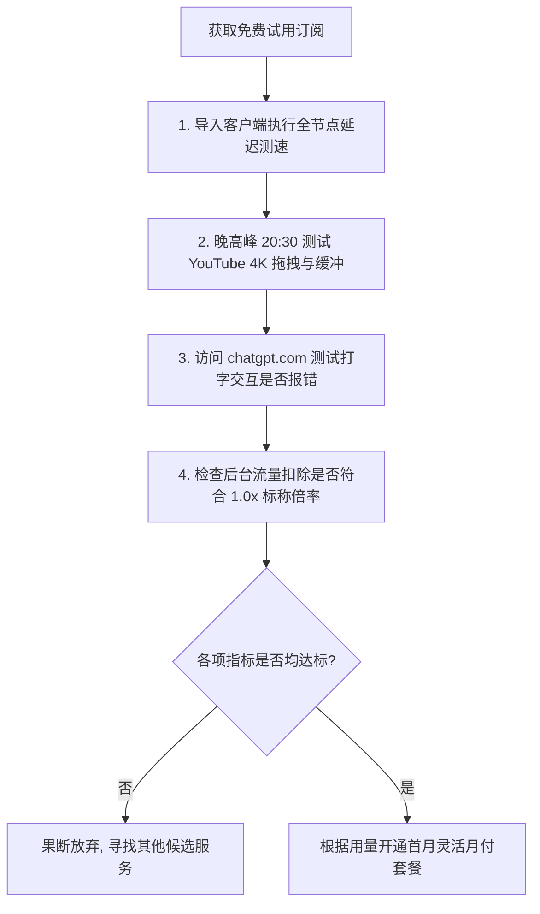

# 2026 免费机场试用精选：支持 0 元体验与 1 元试用避坑指南

<QuickAnswer>
<strong>核心结论：</strong>正规商业机场提供的<strong>免费试用（通常为注册赠送 1GB ~ 10GB 流量或 24-48 小时体验期）</strong>是新手在正式付费前，实机验证本地宽带兼容性、节点延迟、YouTube 4K 秒播以及 ChatGPT/流媒体解锁能力的最佳低成本途径。在体验试用套餐时，<strong>坚决切勿输入真实银行卡号或开启自动续费授权</strong>，并在<strong>晚高峰（20:00-22:30）</strong>执行严格的带宽与稳定性压测。
</QuickAnswer>

## 一、为什么正规机场会提供试用？2026 主流试用形式全景

在选购长期网络代理订阅前，许多新手往往存在合理的顾虑：“买完后在我的电信/移动宽带下会不会频繁掉线？”、“节点能不能解锁美区 Netflix 和 ChatGPT？”

为了消除用户的顾虑并展现技术底气，目前正规服务商主要提供以下三种试用与体验模式：

<ComparisonTable
  :headers="['体验模式', '获取门槛', '流量与有效期', '线路品质与节点范围', '适合人群']"
  :rows="[
    ['0 元无门槛免费试用', '常用邮箱注册即可', '1GB ~ 5GB 流量 / 24 小时', '提供 2-4 个基础测试节点', '纯新手验证本地客户端能否顺利导入与连通'],
    ['1 元防刷体验套餐', '支付 1 元人民币', '10GB ~ 20GB 流量 / 3-7 天', '全量解锁 IEPL 专线与全球节点', '深度测试晚高峰 4K 播放、丢包率与 AI 纯净度'],
    ['月付无忧退款体验', '正规月付 (10-20元)', '全月足额流量 / 30 天', '最高优先级企业级 BGP 专线', '日常主力使用，不捆绑年费，随时退换']
  ]"
/>

### 1. 0 元无门槛免费试用（Free Trial）
- 用户使用常规邮箱注册账号后，系统自动在用户中心发放测试订阅。
- 核心价值：零成本验证客户端环境是否正常配置（如系统代理、TUN 虚拟网卡）。相关客户端配置可参考 [Clash 免费节点配置](/free-node/clash) 与 [v2rayN 节点测速配置](/free-node/v2rayn)。

### 2. 1 元小额体验套餐（Micro Trial）
- 很多高质量专线机场取消了 0 元试用，改为收取 1 元。其目的并非为了牟利，而是**设立防刷门槛**，阻断黑客脚本利用多开虚拟机批量盗取专线带宽，从而确保参与体验的真实用户能享受到真正的满血千兆带宽。

---

## 二、试用期内必须重点测试的 4 项硬核指标

拿到试用订阅链接后，不要仅仅满足于“能打开 Google”。必须在试用期内完成以下 4 项硬性核验：

### 1. 晚高峰速率测试 (Peak Hour Stress Test)
必须在晚上 20:30 ~ 22:30 的全国骨干网拥堵高峰期测试。打开 YouTube 搜索 `4K HDR 60fps` 视频，右键点击“详细统计信息 (Stats for nerds)”：
- **Connection Speed（连接速度）**：应稳定维持在 **50,000 Kbps (50 Mbps)** 以上。
- **Buffer Health（缓冲健康度）**：应持续在 **20 秒以上**，进度条随意拖拽无明显白圈转圈卡顿。

### 2. AI 平台纯净度测试 (AI Clean IP Test)
打开浏览器隐私无痕窗口，直接访问 `chatgpt.com` 或 `claude.ai`：
- 若能直接进入登录界面并正常生成回答，且没有触发 Cloudflare 循环人机验证或 `Access Denied 1020`，说明该试用节点的出口 IP 信誉优秀。
- 更多节点地区选择细节请参考 [国外常用节点地区选型指南](/free-node/regions)。

### 3. 多协议与客户端导入兼容性
测试试用订阅在您的主要设备上能否一键顺利同步：
- Windows 电脑端：[Clash Verge Rev 电脑教程](/tutorial/clash-verge-rev) 或 [v2rayN 实战](/tutorial/v2rayn-windows)
- iOS 苹果端：[Shadowrocket (小火箭) 教程](/tutorial/shadowrocket-ios)
- Android 手机端：Clash Meta for Android (CMFA)

### 4. 流量扣除倍率与重置规则核实
在测试下载或播放一段已知大小（如 1GB）的媒体文件前后，刷新机场用户中心后台，检查实际扣除流量是否严格对应 1.0x 标称倍率，确认不存在暗中以 2.0x 或 3.0x 偷跑流量的恶劣行为。

---

## 三、免费试用避坑与安全防范守则

<TroubleshootingBox
  title="试用过程中的三大常见陷阱与防范技巧"
  :steps="[
    {
      symptom: '要求绑定海外信用卡或要求开通 PayPal 预授权自动扣款',
      solution: '立即关闭页面！正规机场试用绝不强制索要银行卡号或绑定免密扣费，以防试用期结束后遭遇难以取消的霸王自动扣款。'
    },
    {
      symptom: '必须下载其专属定制的未知 .exe 或安装未知 iOS 描述文件',
      solution: '坚决不要安装！只接受提供通用 Clash / Shadowrocket / sing-box 订阅链接的服务，避免设备被植入恶意挖矿脚本或后门。'
    },
    {
      symptom: '试用期间速度极快，但刚充值付费后速度立即断崖式下跌',
      solution: '这是部分黑心商家的“试用诱导”伎俩。防范此套路的最佳法则是：初次开通【坚决只选月付】，切勿因打折优惠而冲动直接购买年付！'
    }
  ]"
/>

---

## 四、新手常见问题解答 (FAQ)

<FaqAccordion :items="[
  {
    q: '为什么我注册了试用账号，却提示“该 IP 注册过多”？',
    a: '很多机场为了防范滥用脚本，会对同一 IP 注册的账号数量进行限制。如果您是在公共 Wi-Fi 或开启了其他代理软件注册，可能会触发此限制。建议断开其他代理，直接使用本地真实网络尝试注册。'
  },
  {
    q: '试用套餐的流量用完了，还能重复注册新账号试用吗？',
    a: '正规机场均禁止多账号恶意刷取试用行为，后台部署了设备指纹和 IP 关联风控，反复注册极易导致 IP 被永久拉黑封禁。如果觉得体验良好，建议按需购买正规月付套餐；若不满意，可寻找其他正规服务商体验。'
  },
  {
    q: '光速云有提供试用或体验通道吗？',
    a: '光速云为了保障正式付费用户的专线带宽纯净度与极速体验，不设易被滥用的公开免审核公用池，但在用户后台提供了极低门槛的短期体验与月付无捆绑方案，并承诺完善的售后退款保障。'
  },
  {
    q: '试用期间节点全部超时显示红字怎么办？',
    a: '若导入试用订阅后测试全部超时，通常是因为本地电脑时间未与北京时间同步、防火墙阻断、或者订阅链接未成功同步最新节点。请查阅【节点全部超时排查指南】进行快速修复。'
  }
]" />

---

## 五、下一步探索与决策路径

<TopicBridge
  title="查看经过严格晚高峰实测的推荐榜单"
  targetLink="/free-airport/recommendations"
  targetText="直达《2026 稳定新手机场推荐清单》"
>
  如果您希望跳过繁琐的逐家试用筛选环节，直接获取全天候稳定、原生支持 ChatGPT 与 4K 秒播的高品质服务，请查看我们的完整实测报告，或查阅 <a href="/free-airport/">免费机场综合指南</a> 建立完整认知。
</TopicBridge>

<BrandCard
  brandName="光速云 (Guangshu Cloud)"
  description="企业级 IEPL BGP 跨境专线，支持灵活月付、不捆绑年费。全原生住宅 IP，秒开 4K/8K 超清视频与 AI 极速响应，享有无忧售后退款支持。"
  affLink="https://sahude.gsyvipaff.com/#/?code=keqgvT5Y"
/>
