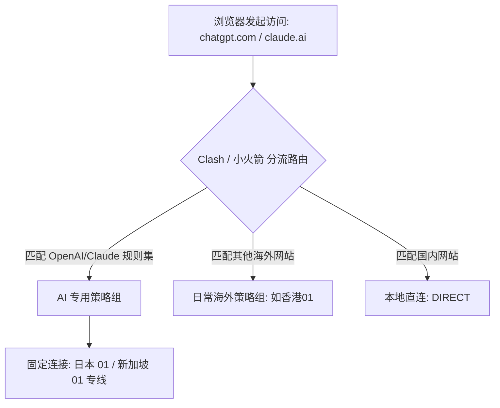

# ChatGPT / Claude / Gemini AI 工具专用节点配置与避坑指南 (2026 最新)

<QuickAnswer>
<strong>核心结论：</strong>访问 ChatGPT、Claude、Gemini 等 AI 服务时，<strong>70% 以上的“打不开、报错 1020、无法加载历史对话或提示地区不可用”都是由于使用了被严重污染的公共/免费代理 IP 引起的</strong>。解决 AI 访问难题的关键在于：<strong>① 避开香港/俄罗斯等未支持地区，优先选择日本、新加坡或美国原生节点；② 在客户端（Clash/小火箭）中为 OpenAI / Anthropic 配置专属分流规则；③ 选用具备低滥用率纯净 IP 的专线服务</strong>。
</QuickAnswer>

## 一、为什么 AI 工具对代理节点的要求如此严苛？

与普通的网页搜索（如 Google Search）不同，OpenAI、Anthropic (Claude) 和 Google 对网络出口实施了**极其严格的反欺诈、防爬虫与合规审查机制**：

```text
用户发起对话 ──> Cloudflare 边缘节点 (检验 IP 纯净度与欺诈评分)
                       │
         ┌─────────────┴─────────────┐
         ▼                           ▼
    【高风险/免费公用 IP】       【纯净原生专线 IP】
    1. 弹出无限循环 5 秒盾       1. 0 验证直接通过
    2. 返回 Access Denied        2. 建立 SSE 流式长连接
    3. 对话断流 / 报错 1020      3. 秒级生成回复文字
```

1. **IP 欺诈分值 (Fraud Score) 过滤**：OpenAI 借助 Cloudflare 与第三方风险数据库，对每一个来访 IP 进行打分。如果某个 IP 被成百上千人同时用来高频调用 API 或注册账号，其信誉分会骤降，直接被封锁在门外。
2. **SSE 流式传输（Server-Sent Events）长连接要求**：AI 模型的打字机逐字回复依赖于持续稳定的 TCP 长连接。如果节点出现丢包或抖动，连接会被瞬间中断，导致页面提示 `An error occurred. Either the engine you requested does not exist or there was another issue processing your request`。

---

## 二、主流 AI 平台对节点地区的硬性支持政策

<ComparisonTable
  :headers="['AI 平台 / 模型', '支持的推荐节点地区', '严格禁止 / 限制地区', '核心封控特点']"
  :rows="[
    ['ChatGPT (OpenAI)', '日本、新加坡、美国、英国、台湾', '中国大陆、中国香港、俄罗斯、伊朗', '检测 IP 欺诈度，高风险 IP 无法加载对话历史或报错 1020'],
    ['Claude (Anthropic)', '美国、英国、日本、新加坡', '中国大陆、中国香港及大多数小众国家', '对 IP 纯净度要求极高，非原生住宅 IP 容易在注册环节直接封号'],
    ['Google Gemini', '美国、日本、新加坡、台湾、欧洲', '中国大陆、中国香港', '与 Google 账号风控绑定，建议使用固定地区节点'],
    ['Perplexity AI', '美国、日本、新加坡、全欧美地区', '中国大陆、中国香港', '支持较宽松，但劣质节点会频繁弹出 Cloudflare 验证']
  ]"
/>

---

## 三、为 AI 平台配置专属分流规则保姆级教程

为了避免看视频的节点影响 AI 访问，推荐在 Clash / Clash Verge Rev 中配置独立的 AI 代理策略组：



### 1. 在 Clash Verge Rev 中指定 AI 节点
1. 打开 Clash Verge Rev，进入 **“代理 (Proxies)”** 界面。
2. 在策略组列表中，找到名为 **`OpenAI / ChatGPT`** 或 **`AI 平台`** 的独立分组。
3. 手动将其锁定为 **`日本 01 [原生专线]`** 或 **`新加坡 01 [原生专线]`**（不要选择“自动选择”，防止 IP 动态飘忽导致掉线）。
4. 保持日常分组继续使用低延迟的 **`香港 01`**，实现“日常低延迟与 AI 稳定可用”兼得。

---

## 四、ChatGPT 常见报错与排查决策树

<TroubleshootingBox
  title="AI 访问报错与排查指南"
  :steps="[
    {
      symptom: '页面提示：Unsupported Country / Region (当前国家地区不受支持)',
      solution: '检查当前使用的节点是否为香港节点。请在客户端中手动切换为【日本】或【美国】节点，关闭浏览器标签页并重新打开访问。'
    },
    {
      symptom: '页面提示：Access Denied (Error code 1020) 或反复出现人机验证',
      solution: '说明当前节点的公网 IP 已被 Cloudflare 列入黑名单（免费节点极为常见）。必须更换为拥有纯净原生 IP 的付费专线节点。'
    },
    {
      symptom: '可以打开登录界面，但点击 Log in 后白屏或无限转圈',
      solution: '请清空浏览器针对 openai.com 的全部 Cookie 和缓存，或使用浏览器的【新建无痕窗口 (Incognito)】进行登录。'
    }
  ]"
/>

---

## 五、新手常见问答 (FAQ)

<FaqAccordion :items="[
  {
    q: '使用免费节点注册 ChatGPT 账号容易被封号吗？',
    a: '是的！OpenAI 在注册阶段对 IP 的风控最为严苛。使用被成百上千人共用的免费节点注册，系统极易将其判定为机器人批量注册而直接封号。建议在注册和绑定手机号阶段使用干净稳定的专线节点。'
  },
  {
    q: '为什么我的节点能看 YouTube 4K，但 ChatGPT 却打不开？',
    a: 'YouTube 对代理 IP 的风控要求非常宽松，只要带宽足够即可流畅播放；而 ChatGPT 重点检测 IP 的安全信誉度与机房属性。能看视频不代表 IP 纯净，这是两种完全不同的考核维度。'
  },
  {
    q: '使用 Claude 为什么提示“App unavailable in your region”？',
    a: 'Anthropic 对地区和 IP 的限制比 OpenAI 更加严格。确保您的客户端开启了“TUN 虚拟网卡模式”或完全接管了 DNS 解析，节点必须切换至美国或英国的原生纯净 IP。'
  }
]" />

---

## 六、下一步探索与专线推荐

<TopicBridge
  title="了解全平台代理客户端的高级安装与分流技巧"
  targetLink="/tutorial/"
  targetText="前往《全平台代理客户端实战教程库》"
>
  掌握如何在 Windows、Mac、iPhone 和 Android 客户端上开启 TUN 虚拟网卡与高级路由分流，让您的 AI 办公体验更加丝滑。
</TopicBridge>

<BrandCard
  brandName="光速云 (Guangshu Cloud)"
  description="专为 AI 生产力开发者与创作者打造。全专线 BGP 节点标配原生纯净 IP，完美支持 ChatGPT-4o、Claude 3.5、Gemini 1.5 与 Midjourney，杜绝 1020 拦截与频繁人机验证。"
  affLink="https://sahude.gsyvipaff.com/#/?code=keqgvT5Y"
/>
