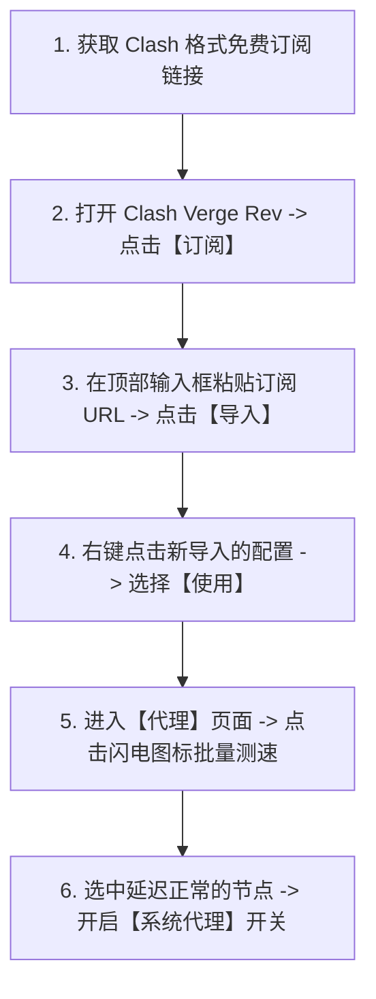

# Clash 免费节点获取、订阅导入与配置使用教程 (2026 最新)

<QuickAnswer>
<strong>核心结论：</strong>在 Clash（推荐使用现代内核的 <strong>Clash Verge Rev</strong>）中配置免费节点的标准流程为：<strong>复制 Clash 格式的订阅 URL → 打开【Profiles / 订阅配置】→ 粘贴 URL 并点击【Save / Import】→ 在【Proxies / 代理】中执行闪电图标延迟测速 → 选择绿色低延迟节点 → 开启【系统代理 (System Proxy)】</strong>。若免费节点出现大面积红字超时，只需右键点击配置选择【Update / 更新】即可拉取最新可用节点。
</QuickAnswer>

## 一、开始前的准备工作与客户端版本说明

随着原版 Clash 内核的停止维护，目前在 Windows、macOS 和 Linux 平台上，推荐使用积极维护的开源现代化客户端：

- **Windows / macOS 首选**：[Clash Verge Rev](https://github.com/clash-verge-rev/clash-verge-rev)（基于 Mihomo / Clash.Meta 核心，界面现代化且支持中文）
- **Android 手机首选**：[Clash Meta for Android (CMFA)](https://github.com/MetaCubeX/ClashMetaForAndroid)

> **注意**：Clash 的配置文件通常以 `.yaml` 或一串包含参数的远程 HTTP 订阅 URL 存在。普通的单个 `vmess://` 或 `ss://` 链接需要先通过订阅转换工具转换为 Clash YAML 格式，或者直接使用支持多协议解析的 Clash Verge Rev 导入。

---

## 二、Clash 导入免费订阅配置分步操作指南

### 步骤 1：获取订阅链接并导入配置
1. 复制您获取到的 Clash 免费订阅 URL（通常格式为 `https://.../api/v1/client/subscribe?token=...&clash=1`）。
2. 打开 Clash Verge Rev 客户端，在左侧导航栏点击 **“订阅 (Profiles)”**。
3. 在顶部输入框中粘贴该链接，可在备注名称中输入 `免费节点源`，随后点击右侧的 **“导入 (Import)”** 按钮。
4. 状态显示为绿色 `Success` 后，鼠标左键单击该卡片，确保其显示为“已激活/正在使用”状态。

### 步骤 2：节点测速与选择
1. 点击左侧导航栏的 **“代理 (Proxies)”** 选项。
2. 模式建议选择 **“规则 (Rule)”**（这样国内网站走本地直连，海外网站走代理节点）。
3. 点击右上角的 **闪电 ⚡ 图标** 或右键执行“测速”，客户端将自动对列表中的所有节点发送握手请求。
4. 忽略显示 `Timeout` 的红色失效节点，选中显示为绿色毫秒数（如 `香港 01 - 25ms`）的节点。

### 步骤 3：开启系统代理与验证
1. 点击左侧导航栏的 **“设置 (Settings)”**。
2. 勾选并开启 **“系统代理 (System Proxy)”** 开关。
3. 打开浏览器访问 `google.com`，确认可以顺畅打开且搜索功能正常。

---

## 三、Clash 免费节点常见问题排查决策

<TroubleshootingBox
  title="Clash 节点使用常见故障与修复"
  :steps="[
    {
      symptom: '导入订阅时提示 Network Error 或 invalid yaml',
      solution: '通常是因为订阅链接格式不正确或被服务商防盗链拦截。尝试在浏览器直接打开该链接看是否返回文本，或使用【订阅转换工具】转换为标准 Clash 规则再导入。'
    },
    {
      symptom: '开启系统代理后浏览器完全断网，国内国外网站均打不开',
      solution: '请先进入 Clash 设置关闭系统代理，检查电脑系统时间是否与标准北京时间完全同步（相差几分钟会导致 TLS 证书握手失败），同步时间后重启 Clash 即可解决。'
    },
    {
      symptom: '节点列表隔天全部变红显示 Timeout',
      solution: '免费节点更新频繁。在【订阅】页面找到该订阅卡片，右键点击选择【更新 (Update)】即可重新拉取服务器最新的有效节点。'
    }
  ]"
/>

---

## 四、新手常见问答 (FAQ)

<FaqAccordion :items="[
  {
    q: 'Clash 的“全局 (Global)”、“规则 (Rule)”和“直连 (Direct)”有什么区别？',
    a: '【规则 (Rule)】是最推荐的日常模式，客户端会根据内置规则列表自动判断：访问国内百度/微信时直连，访问海外 Google/YouTube 时走代理；【全局 (Global)】会让所有流量均走代理，容易导致国内 App 变慢或报异地登录；【直连 (Direct)】则不使用任何代理。'
  },
  {
    q: '为什么别人给的单节点链接（如 ss:// 或 vless://）不能直接填到 Clash 订阅框？',
    a: 'Clash 订阅框只接受远程标准的 YAML 配置文件 URL。如果只有单个节点链接，可以借助在线订阅转换工具生成 Clash 订阅，或者直接改用支持单节点直接粘贴的 v2rayN 客户端。'
  },
  {
    q: 'Clash Verge Rev 里的 TUN 模式是什么时候开启的？',
    a: 'TUN 模式会虚拟出一张虚拟网卡，接管电脑上所有不遵守系统代理设置的软件（如命令行终端 CMD、部分游戏客户端、Git 等）。日常普通浏览器上网开启“系统代理”即可，遇到特定软件无法走代理时再开启 TUN 模式。'
  }
]" />

---

## 五、下一步探索

<TopicBridge
  title="想要一劳永逸告别手动更新节点的麻烦？"
  targetLink="/free-airport/recommendations"
  targetText="查看《2026 稳定新手机场实测推荐》"
>
  免费节点需要频繁手动寻找与更新。若您希望拥有一键自动同步、晚高峰 8K 极速秒播的高品质专线节点，欢迎查阅我们的稳定选型清单。
</TopicBridge>

<BrandCard
  brandName="光速云 (Guangshu Cloud)"
  description="深度适配 Clash Verge Rev / Clash Meta 全系列客户端。提供一键复制与专属导入功能，全专线 BGP 节点全天候稳定在线，新用户支持月付体验与退款保障。"
  affLink="https://sahude.gsyvipaff.com/#/?code=keqgvT5Y"
/>
