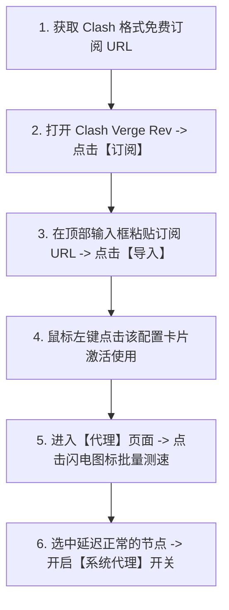

# Clash 免费节点获取与配置教程：Clash Verge 免费订阅链接与配置文件模板 (2026)

<QuickAnswer>
<strong>核心结论：</strong>在 Clash（推荐使用现代内核的 <strong>Clash Verge Rev</strong>）中配置免费节点的标准流程为：<strong>① 复制 Clash 格式的免费订阅 URL 或 YAML 配置文件 → ② 打开【订阅 (Profiles)】粘贴导入或新建本地配置 → ③ 右键点击卡片选择【使用】激活 → ④ 在【代理 (Proxies)】中点击闪电图标批量测速并选中绿色低延迟节点 → ⑤ 在【设置】中开启【系统代理】</strong>。若节点全部变红超时，点击右键【更新】即可同步最新可用节点池。
</QuickAnswer>

## 一、开始前的准备工作与客户端版本说明

随着原版 Clash 内核与 Clash for Windows (CFW) 的停更，目前在 Windows、macOS 和 Linux 电脑端，推荐使用全面适配新协议的开源现代化客户端：

- **Windows / macOS 首选客户端**：[Clash Verge Rev](https://github.com/clash-verge-rev/clash-verge-rev)（内置最新的 **Mihomo / Clash.Meta** 核心，原生支持 Hysteria 2、VLESS-Reality 等协议，详细图文见 [Clash Verge Rev 电脑配置教程](/tutorial/clash-verge-rev)）
- **Android 手机客户端**：[Clash Meta for Android (CMFA)](https://github.com/MetaCubeX/ClashMetaForAndroid)
- **iOS 苹果端**：推荐搭配 [Shadowrocket (小火箭)](/tutorial/shadowrocket-ios) 使用通用订阅

> **协议格式提示**：Clash 的配置文件必须遵循标准 YAML 语法结构。如果手中仅有散落的单个 `vmess://`、`vless://` 或 `ss://` 节点链接，不能直接粘贴到远程订阅框中，需先通过 [在线订阅转换工具](/tutorial/sub-conversion) 转换为 Clash 格式，或采用下文介绍的“本地 YAML 配置文件导入法”。

---

## 二、Clash 导入免费订阅链接分步指南 (Clash Verge Rev)



### 步骤 1：获取订阅链接并导入配置
1. 复制获取到的 Clash 免费订阅链接（通常形如 `https://.../api/v1/client/subscribe?token=...&clash=1`）。
2. 打开 Clash Verge Rev 客户端，在左侧导航栏点击 **“订阅 (Profiles)”**。
3. 在顶部“订阅链接输入框”中粘贴该 URL，在名称中可备注为 `免费节点订阅`，随后点击右侧的 **“导入 (Import)”** 按钮。
4. 状态提示为绿色 `Success` 后，鼠标单击该卡片使其高亮（显示为激活勾选状态）。

### 步骤 2：节点批量测速与优质节点筛选
1. 点击左侧导航栏的 **“代理 (Proxies)”** 选项。
2. 运行模式建议选择 **“规则 (Rule)”**（访问国内百度、淘宝直连，访问海外 Google、GitHub 自动走代理节点）。
3. 点击右上角的 **闪电 ⚡ 图标** 执行批量测速，客户端将自动对列表中的所有节点发送 HTTP 握手测速包。
4. 忽略显示 `Timeout` 的红色失效节点，选中显示为绿色低延迟数字（如 `香港 01 - 25ms` 或 `日本 02 - 45ms`）的节点。关于各区域节点延迟特性可参考 [国外常用节点地区选型对比](/free-node/regions)。

### 步骤 3：开启系统代理与连通性验证
1. 点击左侧导航栏的 **“设置 (Settings)”**。
2. 勾选并开启 **“系统代理 (System Proxy)”** 开关。
3. 打开浏览器新建标签页访问 `google.com`，确认可以顺畅打开且搜索功能正常。

---

## 三、Clash 免费配置文件结构详解与标准 YAML 模板

对于需要本地离线使用、或者不想依赖第三方远程订阅服务器的用户，直接使用 **本地 Clash 配置文件 (config.yaml)** 是最可靠的方案。

### 1. 标准免配置 Clash YAML 配置文件模板
以下为精简且完整的标准 Clash 配置文件范例，包含了基础端口、智能分流规则组以及节点定义格式：

```yaml
# ==========================================
# Clash 标准本地配置文件模板 (支持 Mihomo / Clash Verge)
# ==========================================
port: 7890
socks-port: 7891
mixed-port: 7890
allow-lan: false
mode: rule
log-level: info
external-controller: 127.0.0.1:9090

# 1. 节点定义区域 (将示例节点替换为您获取到的真实节点参数)
proxies:
  - name: "香港 01 示例节点"
    type: ss
    server: 1.2.3.4
    port: 8388
    cipher: aes-128-gcm
    password: "your_password_here"

  - name: "日本 02 示例节点 (VMess)"
    type: vmess
    server: 5.6.7.8
    port: 443
    uuid: "a1b2c3d4-e5f6-7890-abcd-ef1234567890"
    alterId: 0
    cipher: auto
    tls: true
    network: ws
    ws-opts:
      path: "/v2ray"

# 2. 策略分流组
proxy-groups:
  - name: PROXY
    type: select
    proxies:
      - "香港 01 示例节点"
      - "日本 02 示例节点 (VMess)"
      - DIRECT

  - name: 自动选择
    type: url-test
    url: http://www.gstatic.com/generate_204
    interval: 300
    tolerance: 50
    proxies:
      - "香港 01 示例节点"
      - "日本 02 示例节点 (VMess)"

# 3. 基础分流规则 (国内直连，国外走代理)
rules:
  - DOMAIN-SUFFIX,google.com,PROXY
  - DOMAIN-SUFFIX,github.com,PROXY
  - DOMAIN-SUFFIX,youtube.com,PROXY
  - DOMAIN-KEYWORD,chatgpt,PROXY
  - DOMAIN-KEYWORD,openai,PROXY
  - GEOIP,CN,DIRECT
  - MATCH,PROXY
```

### 2. 如何在 Clash Verge Rev 中导入本地配置文件？
1. 在电脑上新建一个文本文件，将上述内容保存为 `my-clash-config.yaml`。
2. 打开 Clash Verge Rev，进入左侧 **“订阅 (Profiles)”**。
3. 点击右上角的 **“新建 (New)”** 按钮。
4. 在类型中选择 **“本地文件 (Local)”**，输入名称并点击保存。
5. 右键点击新创建的文件卡片，选择 **“编辑文件 (Edit File)”**，将 YAML 内容粘贴覆盖并保存。
6. 左键单击激活该配置，即可在【代理】页面查看并使用配置中的节点。

---

## 四、免费公共节点 vs 试用专线 vs 商业节点全方位对比

在选择使用免费资源时，了解不同节点类型的承载极限有助于避免关键工作被延误：

<ComparisonTable
  :headers="['评估指标', '公用爬虫免费节点', '正规机场免费试用节点', '商业级 IEPL 专线节点']"
  :rows="[
    ['获取门槛', '0 元，公开网页直接抓取', '0 元或 1 元（常用邮箱注册）', '月付 10-30 元'],
    ['有效存活周期', '数小时至 1 天 (极易失效)', '体验期全程有效 (24h-72h)', '全天候 365 天持续保障'],
    ['晚高峰连通率', '频繁断流、大面积超时', '优良（与付费主干同机房）', '99.9% 稳定、0 丢包'],
    ['ChatGPT/流媒体', '基本被封禁 (报错 1020/403)', '大部分原生支持', '企业级原生纯净 IP 全解锁'],
    ['隐私与审计安全', '存在中间人嗅探风险', '正规商户运营，协议加密', '端到端加密、严格无日志']
  ]"
/>

如果需要长期用于学术查阅、日常看 4K 视频或 AI 交互，建议优先查阅 [支持免费试用的机场精选指南](/free-airport/trials)，先在本地环境验证速度与解锁效果。

---

## 五、Clash 免费节点高频报错排查决策树

<TroubleshootingBox
  title="Clash 节点使用常见故障与修复"
  :steps="[
    {
      symptom: '导入订阅时提示 Network Error 或 invalid yaml',
      solution: '通常是因为订阅链接格式不正确或被服务商防盗链拦截。尝试在浏览器直接打开该链接看是否返回文本，或使用【订阅转换工具】转换为标准 Clash 规则再导入。'
    },
    {
      symptom: '开启系统代理后浏览器完全断网，国内国外网站均打不开',
      solution: '请先进入 Clash 设置关闭系统代理，检查电脑系统时间是否与标准北京时间完全同步（相差几分钟会导致 TLS 证书握手失败），同步时间后重启 Clash 即可解决。详见【已连接但无法上网排查】。'
    },
    {
      symptom: '节点列表隔天全部变红显示 Timeout',
      solution: '免费节点更新频繁。在【订阅】页面找到该订阅卡片，右键点击选择【更新 (Update)】即可重新拉取服务器最新的有效节点。若依然全红请查阅【节点全部超时排查】。'
    }
  ]"
/>

---

## 六、新手常见问答 (FAQ)

<FaqAccordion :items="[
  {
    q: '如何获取最新有效的 Clash 免费订阅链接？',
    a: '获取正规免费订阅链接最稳妥的方式是通过支持免费体验的正规机场服务商后台领取（通常赠送 1-10GB 流量体验），或者通过 GitHub 上的开源聚合项目获取。切记避开要求输入银行卡或下载捆绑专属软件的不良网站。'
  },
  {
    q: 'Clash 的“全局 (Global)”、“规则 (Rule)”和“直连 (Direct)”有什么区别？',
    a: '【规则 (Rule)】是最推荐的日常模式，客户端会根据内置规则列表自动判断：访问国内百度/微信时直连，访问海外 Google/YouTube 时走代理；【全局 (Global)】会让所有流量均走代理，容易导致国内 App 变慢或报异地登录；【直连 (Direct)】则不使用任何代理。'
  },
  {
    q: '为什么别人给的单节点链接（如 ss:// 或 vless://）不能直接填到 Clash 订阅框？',
    a: 'Clash 订阅框只接受远程标准的 YAML 配置文件 URL。如果只有单个节点链接，可以借助在线订阅转换工具生成 Clash 订阅，或者直接改用支持单节点直接粘贴的 v2rayN 客户端。'
  },
  {
    q: 'Clash Verge Rev 里的 TUN 模式是什么时候开启的？',
    a: 'TUN 模式会虚拟出一张虚拟网卡，接管电脑上所有不遵守系统代理设置的软件（如命令行终端 CMD、部分游戏客户端、Git 等）。日常普通浏览器上网开启“系统代理”即可，遇到特定软件无法走代理时再开启 TUN 模式。'
  }
]" />

---

## 七、下一步探索

<TopicBridge
  title="想要一劳永逸告别手动更新节点的麻烦？"
  targetLink="/free-airport/recommendations"
  targetText="查看《2026 稳定新手机场实测推荐》"
>
  免费节点需要频繁手动寻找与更新。若您希望拥有一键自动同步、晚高峰 8K 极速秒播的高品质专线节点，欢迎查阅我们的稳定选型清单，或查阅 <a href="/free-airport/trials">支持免费试用的机场精选</a> 进行实机验证。
</TopicBridge>

<BrandCard
  brandName="光速云 (Guangshu Cloud)"
  description="深度适配 Clash Verge Rev / Clash Meta 全系列客户端。提供一键复制与专属导入功能，全专线 BGP 节点全天候稳定在线，新用户支持月付体验与退款保障。"
  affLink="https://sahude.gsyvipaff.com/#/?code=keqgvT5Y"
/>
