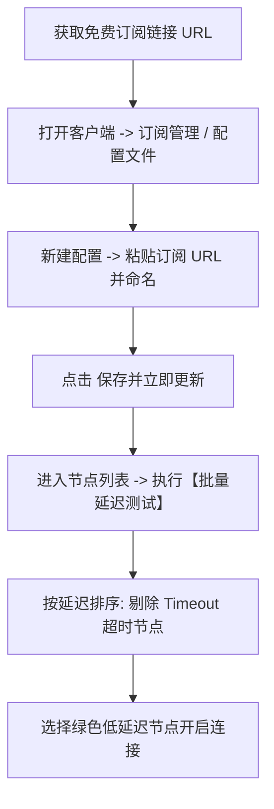

# 免费节点与订阅源获取使用指南：Clash / v2rayN / 小火箭节点配置 (2026)

<QuickAnswer>
<strong>核心结论：</strong>免费节点通常以<strong>单节点链接（如 vmess://, vless://, ss://, hysteria2://）或批量聚合订阅 URL（Base64/YAML）</strong>的形式存在。使用免费节点时，<strong>切勿手动单个复制粘贴</strong>（维护成本极高且极易失效），而应<strong>使用客户端的“订阅管理”功能并设置“自动定时更新”</strong>。由于公用免费节点平均存活周期仅数小时至数天，日常使用中若出现大面积超时，通常只需一键刷新订阅或使用测速工具剔除失效节点。
</QuickAnswer>

## 一、什么是“节点”？什么是“订阅链接”？

对于初学者而言，理解以下几个核心概念是高效使用网络工具的基础：

```text
┌─────────────────────────────────────────────────────────────┐
│                      【订阅链接 (Subscription URL)】          │
│   https://example.com/api/v1/client/subscribe?token=xxxx   │
└──────────────────────────────┬──────────────────────────────┘
                               │ 一键拉取与解析
                               ▼
  ┌─────────────────┬─────────────────┬─────────────────┐
  │ 节点 1: 香港 01 │ 节点 2: 日本 02 │ 节点 3: 美国 03 │ ... (几十个节点)
  │ (IP: 104.x.x.x) │ (IP: 172.x.x.x) │ (IP: 198.x.x.x) │
  └─────────────────┴─────────────────┴─────────────────┘
```

1. **单节点 (Node / Server)**：代表一台位于特定国家或地区的海外代理服务器，包含了连接所需的 IP 地址、端口、加密协议、UUID 密码及传输协议配置。
2. **订阅链接 (Subscription URL)**：一个指向云端配置文件的 HTTP/HTTPS 链接。客户端（如 Clash、v2rayN、小火箭）只需保存该 URL，每次点击“更新订阅”，就能自动同步最新的几十甚至上百个可用节点，无需手动逐一添加。

---

## 二、六大核心节点专题集群 (按客户端与需求直达)

<div class="grid grid-cols-1 sm:grid-cols-2 lg:grid-cols-3 gap-4 my-6">

<div class="p-4 rounded-xl border border-blue-200 dark:border-blue-900 bg-blue-50/40 dark:bg-blue-950/20">
  <h3 class="text-base font-bold text-blue-900 dark:text-blue-300 mb-2">
    <a href="/free-node/clash" class="no-underline text-blue-700 dark:text-blue-400 hover:underline">
      💻 Clash 免费节点与配置 →
    </a>
  </h3>
  <p class="text-xs text-slate-600 dark:text-slate-300">
    Clash Verge Rev 免费订阅链接导入、标准免配置 YAML 模板与批量闪电测速。
  </p>
</div>

<div class="p-4 rounded-xl border border-indigo-200 dark:border-indigo-900 bg-indigo-50/40 dark:bg-indigo-950/20">
  <h3 class="text-base font-bold text-indigo-900 dark:text-indigo-300 mb-2">
    <a href="/free-node/v2rayn" class="no-underline text-indigo-700 dark:text-indigo-400 hover:underline">
      ⚡ v2rayN 免费节点与测速 →
    </a>
  </h3>
  <p class="text-xs text-slate-600 dark:text-slate-300">
    Windows 端单节点 Ctrl+V 直粘、订阅更新 (Ctrl+U) 与真连接延迟测试 (Ctrl+R)。
  </p>
</div>

<div class="p-4 rounded-xl border border-sky-200 dark:border-sky-900 bg-sky-50/40 dark:bg-sky-950/20">
  <h3 class="text-base font-bold text-sky-900 dark:text-sky-300 mb-2">
    <a href="/free-node/shadowrocket" class="no-underline text-sky-700 dark:text-sky-400 hover:underline">
      🍎 小火箭免费节点与添加 →
    </a>
  </h3>
  <p class="text-xs text-slate-600 dark:text-slate-300">
    iOS 苹果 iPhone / iPad 小火箭节点添加、二维码扫描与连通性测试。
  </p>
</div>

<div class="p-4 rounded-xl border border-emerald-200 dark:border-emerald-900 bg-emerald-50/40 dark:bg-emerald-950/20">
  <h3 class="text-base font-bold text-emerald-900 dark:text-emerald-300 mb-2">
    <a href="/free-node/regions" class="no-underline text-emerald-700 dark:text-emerald-400 hover:underline">
      🌐 国外节点怎么选与延迟对比 →
    </a>
  </h3>
  <p class="text-xs text-slate-600 dark:text-slate-300">
    香港、日本、美国、新加坡国外节点物理延迟、4K 流媒体与 AI 解锁对比。
  </p>
</div>

<div class="p-4 rounded-xl border border-purple-200 dark:border-purple-900 bg-purple-50/40 dark:bg-purple-950/20">
  <h3 class="text-base font-bold text-purple-900 dark:text-purple-300 mb-2">
    <a href="/free-node/ai-nodes" class="no-underline text-purple-700 dark:text-purple-400 hover:underline">
      🤖 ChatGPT / AI 工具专用节点 →
    </a>
  </h3>
  <p class="text-xs text-slate-600 dark:text-slate-300">
    彻底解决 OpenAI、Claude 与 Gemini 报地区不支持与 1020 拦截问题。
  </p>
</div>

<div class="p-4 rounded-xl border border-amber-200 dark:border-amber-900 bg-amber-50/40 dark:bg-amber-950/20">
  <h3 class="text-base font-bold text-amber-900 dark:text-amber-300 mb-2">
    <a href="/free-airport/trials" class="no-underline text-amber-700 dark:text-amber-400 hover:underline">
      🎁 免费机场试用精选指南 →
    </a>
  </h3>
  <p class="text-xs text-slate-600 dark:text-slate-300">
    精选支持 0 元体验与 1 元试用的正规专线机场，免去手动抓取失效节点的烦恼。
  </p>
</div>

</div>

---

## 三、主流节点协议对比与特征解析

目前主流代理节点主要基于以下几种传输协议构建：

<ComparisonTable
  :headers="['协议类型', '协议前缀', '主要特点', '抗封锁与抗丢包能力', '适用客户端']"
  :rows="[
    ['Shadowsocks (SS/SS-2022)', 'ss://', '轻量级、系统资源开销极小、延迟极低', '中等 (需配合优质中转专线)', '全平台客户端通用支持'],
    ['VMess / V2Ray', 'vmess://', '成熟稳定、支持 WebSocket + TLS 伪装', '良好 (伪装成正常 HTTPS 流量)', 'v2rayN / Clash / 小火箭'],
    ['VLESS + Reality', 'vless://', '去除多余加密层、性能强悍、真实网站证书伪装', '极强 (难以被主动探测特征识别)', 'sing-box / v2rayN / Clash Verge'],
    ['Trojan', 'trojan://', '直接模仿标准 HTTPS 协议、伪装度极高', '极高 (流量特征完全等同于网站访问)', '全平台客户端通用支持'],
    ['Hysteria 2 (歇斯底里)', 'hy2:// / hysteria2://', '基于 UDP/QUIC 协议、专门解决恶劣丢包网络', '极强 (弱网/丢包环境下依然能跑满带宽)', 'sing-box / Clash Verge Rev / 小火箭']
  ]"
/>

---

## 四、免费节点与订阅源的获取途径及注意事项

互联网上获取免费节点的主流公开途径包括：

1. **GitHub 公益开源项目**：在 GitHub 上搜索 `free-nodes` 或 `clash-subs`，许多开发者利用自动化 Action 脚本定时聚合全网公开发布的节点池。
2. **Telegram 公益技术频道**：部分网络社群每日定时推送 Base64 格式的节点订阅源。
3. **商业机场的免费体验与签到套餐**：正规商户提供的试用订阅源，稳定性显著高于公开爬虫池。详见 [免费机场试用精选指南](/free-airport/trials)。

> **重要安全警示**：公开爬虫抓取的节点中，可能混杂着黑客故意搭建的“蜜罐节点 (Honeypot)”，用于记录未加密请求。**切勿通过公共爬虫节点传输含有个人身份、工作业务及金融支付的信息**。详见 [开源免费节点安全审计](/free-node/public-free-nodes-security)。

---

## 五、客户端导入与批量测速维护流程

为了高效管理免费节点，建议遵循以下标准操作流程：



1. **设置自动更新周期**：在客户端配置中，将免费订阅的自动更新间隔设置为 **12 小时至 24 小时**，确保及时拉取最新补全的有效节点。
2. **启用分流规则（规则模式 / Rule）**：避免使用“全局模式 (Global)”，确保国内常用网站（百度、微信、淘宝）直接走本地直连，节省代理带宽并避免国内应用报异地登录异常。

---

## 六、新手常见问题解答 (FAQ)

<FaqAccordion :items="[
  {
    q: '为什么刚导入的免费节点测速全部显示红色 Timeout？',
    a: '公开节点的存活时间通常非常短暂。如果显示全部超时，通常说明该订阅源的提供者尚未更新服务器，或者该批 IP 已经失效。请尝试手动右键点击“更新订阅”，若依然全部超时，请查阅【节点全部超时排查指南】。'
  },
  {
    q: '单节点链接（如 vmess:// 开头）怎么在电脑上导入？',
    a: '复制该链接到剪贴板后，打开 v2rayN 客户端按下快捷键 Ctrl+V，或打开 Clash Verge Rev 点击“新建配置”选择“从剪贴板导入”即可。'
  },
  {
    q: '为什么免费节点测速延迟很低，但打开网页却非常慢甚至卡住？',
    a: '客户端的“延迟测试 (Ping/URL Test)”通常只测试了握手连通的耗时（几毫秒到几十毫秒），并不代表实际下载带宽。免费节点如果被数百人同时使用，虽然 Ping 延迟低，但实际带宽已被占满，导致传输数据极其缓慢。'
  }
]" />

---

## 七、下一步探索

<TopicBridge
  title="想要一劳永逸告别手动更新节点的麻烦？"
  targetLink="/free-airport/recommendations"
  targetText="查看《2026 稳定新手机场实测推荐》"
>
  免费节点需要频繁手动寻找与更新。若您希望拥有一键自动同步、晚高峰 8K 极速秒播的高品质专线节点，欢迎查阅我们的稳定选型清单，或查阅 <a href="/free-airport/trials">免费机场试用精选</a> 进行实机验证。
</TopicBridge>

<BrandCard
  brandName="光速云 (Guangshu Cloud)"
  description="告别频繁寻找和更新免费节点的烦恼！光速云提供全自动维护的 IEPL 跨境专线节点订阅，全平台一键同步，原生解锁 AI 与全网 8K 流媒体，支持月付无捆绑与售后保障。"
  affLink="https://sahude.gsyvipaff.com/#/?code=keqgvT5Y"
/>
