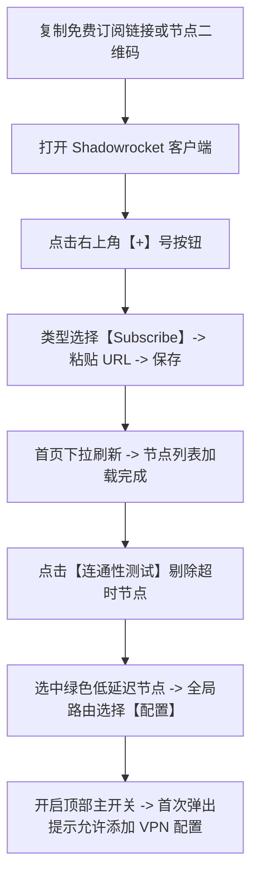

# iOS Shadowrocket (小火箭) 免费节点添加、订阅导入与配置使用教程

<QuickAnswer>
<strong>核心结论：</strong>在 iPhone / iPad 上使用 Shadowrocket（小火箭）配置免费节点的步骤：<strong>① 复制订阅 URL 后打开小火箭，点击右上角【+】号；② 类型选择【Subscribe (订阅)】，在 URL 栏粘贴链接并点击右上角【完成】；③ 首页下滑刷新自动拉取节点，点击【连通性测试】测试延迟；④ 选中延迟正常的绿色节点，全局路由建议选择【配置 (Config)】，打开最顶部的连接开关即可</strong>。
</QuickAnswer>

## 一、Shadowrocket（小火箭）客户端基础须知

Shadowrocket（俗称“小火箭”）是 iOS / iPadOS 生态中最具代表性的规则分流代理客户端之一。

### 1. 正规下载与账号安全须知
- Shadowrocket 为海外 App Store 付费应用（售价 $2.99 美元），**中国大陆区 App Store 无法直接搜索下载**。
- **正规获取方式**：建议自行注册一个免费的海外（如美区、日区、港区）Apple ID，通过购买正规 App Store 礼品卡充值后在官方商店购买下载。
- **安全警告**：切勿在 iPhone 的系统【设置】中直接登录网上来源不明的“共享 Apple ID”，否则可能触发 iCloud 锁机被勒索！仅允许在 App Store 应用内部切换临时账号下载。

---

## 二、小火箭添加免费节点与订阅完整步骤

### 步骤 1：添加订阅源
1. 复制您获取到的通用或小火箭订阅链接。
2. 打开 Shadowrocket 客户端，点击主界面右上角的 **`+`** 按钮。
3. 点击 **“类型 (Type)”**，将其切换为 **`Subscribe (订阅)`**（注意不是默认的 Shadowsocks）。
4. 在 **“URL”** 输入框中长按粘贴刚才复制的订阅链接，在“备注”中可输入 `免费订阅`。
5. 点击右上角的 **“完成 (Done)”** 保存。

### 步骤 2：自动拉取与连通性测试
1. 回到小火箭首页，按住屏幕向下拉动刷新，客户端将自动连接服务器并展示该订阅下的所有节点。
2. 点击列表中间的 **“连通性测试 (Connectivity Test)”**。
3. 稍等 2 秒，每个节点右侧将出现延迟数值。选择显示为绿色数字（如 `35ms`）的节点。

### 步骤 3：配置全局路由与开启连接
1. 在首页中部的 **“全局路由 (Global Routing)”** 选项中，确保选择为 **`配置 (Config)`**（此模式等同于 Clash 的规则分流，国内应用直连，海外应用走代理）。
2. 拨动最顶部的 **主连接开关**。
3. 首次开启时，iOS 系统会弹窗提示“Shadowrocket 想要添加 VPN 配置”，点击 **“允许 (Allow)”** 并输入手机锁屏密码即可完成初始化。

---

## 三、小火箭常见故障排查决策

<TroubleshootingBox
  title="小火箭使用常见问题与解决办法"
  :steps="[
    {
      symptom: '添加订阅后下拉刷新提示 Error 404 或解析失败',
      solution: '检查复制的链接是否包含了多余的空格或中文符号；如果是在 Safari 浏览器中复制，尝试重新长按完整复制，或更换为其他格式的订阅源。'
    },
    {
      symptom: '连接开关开启后，手机状态栏出现 VPN 图标，但所有网页无法访问',
      solution: '检查是否将全局路由误选为了未配置的【代理】模式，建议切回【配置】。若依然无法打开，点击底部【配置】-> 选择 default.conf 恢复默认分流规则。'
    },
    {
      symptom: '使用一段时间后，所有节点延迟测试全部显示 Timeout',
      solution: '免费节点已经失效。在订阅分组名称上向左滑动，点击【更新】拉取最新节点；若仍超时，说明该免费源已被封锁，需更换新的可用订阅源。'
    }
  ]"
/>

---

## 四、新手常见问答 (FAQ)

<FaqAccordion :items="[
  {
    q: '小火箭可以导入单一节点的二维码或链接吗？',
    a: '可以。直接在小火箭首页点击左上角的“扫码图标”扫描节点二维码；或者在剪贴板复制单节点链接（如 vmess:// 开头）后打开小火箭，软件会自动提示“检测到剪贴板中的节点，是否添加”，点击确定即可。'
  },
  {
    q: '小火箭开启后耗电量很大是正常的吗？',
    a: 'iOS 系统会将所有经过代理转发的网络流量计入 Shadowrocket 的电量统计中，造成它“耗电极高”的视觉假象。实际上小火箭内核采用高效 C 语言编写，待机耗电非常低，无需过于担心。'
  },
  {
    q: '小火箭如何设置定时自动更新订阅？',
    a: '点击底部【设置】->【订阅 (Subscribe)】-> 开启“打开时更新”和“自动后台更新”，这样每次打开软件都会自动同步最新的可用节点。'
  }
]" />

---

## 五、下一步探索

<TopicBridge
  title="想要拥有全天候高速、免频繁更新的专线订阅？"
  targetLink="/free-airport/recommendations"
  targetText="查看《2026 稳定新手机场实测推荐》"
>
  小火箭完美支持光速云的一键导入功能。享受全专线极速网络、原生解锁 TikTok、Instagram、YouTube 与 ChatGPT。
</TopicBridge>

<BrandCard
  brandName="光速云 (Guangshu Cloud)"
  description="深度适配 iOS Shadowrocket (小火箭)。支持在手机后台一键直接唤起小火箭完成订阅导入，全 IEPL BGP 专线保障，秒开海外 App，支持月付体验与售后退款。"
  affLink="https://sahude.gsyvipaff.com/#/?code=keqgvT5Y"
/>
