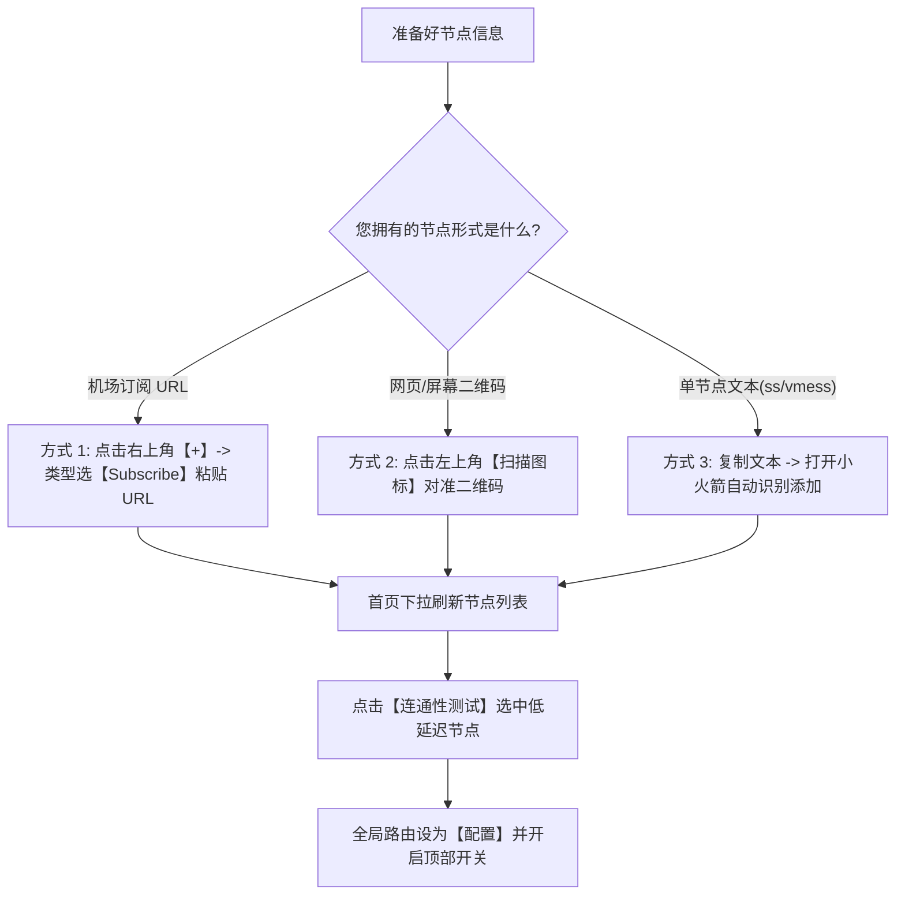

# iOS Shadowrocket (小火箭) 安装与配置教程：小火箭怎么添加节点与分流实战 (2026)

<QuickAnswer>
<strong>核心结论：</strong>在苹果 iOS 设备（iPhone/iPad）上配置代理的最佳工具是 <strong>Shadowrocket（小火箭）</strong>。小火箭添加节点最快速的方式为：<strong>打开小火箭点击右上角【+】号 → 类型选择【Subscribe】→ 粘贴机场订阅 URL 并点击【完成】→ 首页下拉屏幕刷新拉取全部节点 → 点击【连通性测试】选中绿色低延迟节点 → 全局路由设为【配置 (Config)】并开启顶部主连接开关</strong>。
</QuickAnswer>

## 一、Shadowrocket（小火箭）官方正规获取指南

由于地区应用商店政策原因，Shadowrocket 仅在**中国大陆以外的 App Store** 上架（售价 $2.99 美元）。

### 1. 安全正规的下载步骤
1. **准备一个海外 Apple ID**（美区、港区或日区均可，可在苹果官网免费注册）。
2. 打开 iPhone 上的 **App Store**，点击右上角个人头像拉到最底部，点击 **“退出登录 (Sign Out)”**。
3. 在 App Store 重新登录您的海外 Apple ID（**切勿在 iPhone 系统“设置”中登录 iCloud，仅在 App Store 登录！**）。
4. 购买正规 App Store 礼品卡充值后，在商店搜索 `Shadowrocket`（开发者为 *Shadow Launch Technology Limited*，图标为一个白色四翼小火箭背景为深蓝色）并完成购买下载。
5. 下载完成后，在 App Store 退出海外账号，换回您的日常主力 Apple ID 即可（已下载的应用不受任何影响）。

---

## 二、小火箭怎么添加节点？（订阅/二维码/剪贴板三种添加方式全解析）

小火箭支持多种灵活的节点导入机制，无论是商业机场订阅还是单个免费节点，均可轻松添加：

### 方式 1：通过订阅链接批量添加节点 (最推荐、最省心)
1. 登录您的机场服务后台（如 [光速云](/product/guangshuyun) 或 [免费试用机场](/free-airport/trials)），复制专属的 **Shadowrocket / 通用订阅链接**。
2. 打开 Shadowrocket 客户端，点击主界面右上角的 **`+`** 按钮。
3. 点击第一项 **“类型 (Type)”**，将其从默认的 Shadowsocks 改选为 **`Subscribe (订阅)`**。
4. 在 **“URL”** 一栏中长按并粘贴刚才复制的订阅链接，在“备注”中输入 `专线节点源`。
5. 点击右上角的 **“完成 (Done)”** 保存。
6. 回到首页，用手指在屏幕中间向下轻拉并松开，客户端将自动同步拉取几十个可用节点。

### 方式 2：扫描屏幕二维码一键添加
1. 如果在电脑屏幕或朋友手机上看到节点/订阅的二维码。
2. 打开小火箭，点击首页左上角的 **扫描图标（二维码扫描器）**。
3. 对准屏幕上的二维码扫描，小火箭会自动识别协议并弹窗提示“保存”，点击保存即可秒级录入。

### 方式 3：通过剪贴板单节点文本导入
1. 在网页、微信或 Telegram 中复制以 `ss://`、`vmess://`、`vless://`、`trojan://` 或 `hysteria2://` 开头的单节点链接。
2. 切换回小火箭客户端，软件检测到剪贴板有节点数据时，会自动弹窗提示“是否从剪贴板添加节点”，点击“是”即可导入。

---

## 三、节点连通性测试与分流配置实操

### 步骤 1：批量延迟测速
1. 节点导入完成后，点击节点列表中部的 **“连通性测试 (Connectivity Test)”**。
2. 节点右侧会快速刷新出延迟毫秒数，选择显示为绿色低延迟的节点（如 `香港 01` 或 `日本 01`）。各地区节点的延迟特性与 AI 解锁能力详见 [国外常用节点地区选型对比](/free-node/regions)。

### 步骤 2：确认全局路由模式
在首页中部的 **“全局路由”** 中，确保选择为 **`配置 (Config)`**：
- **配置 (Config)**：智能分流模式。国内百度、微信、外卖直连，海外网站走代理。
- **代理 (Proxy)**：全局代理。所有流量均绕行海外节点，国内 App 容易变慢或报异地登录。
- **直连 (Direct)**：不通过任何节点直接上网。

### 步骤 3：开启主开关并完成系统授权
1. 拨动最顶部的 **主连接开关**。
2. 首次开启时，iOS 系统会弹窗提示“Shadowrocket 想要添加 VPN 配置”，点击 **“允许 (Allow)”**，并输入您的 iPhone 锁屏密码即可完成连接。
3. 状态栏出现 VPN 小图标，打开 Safari 访问 `google.com` 即可畅通无阻。

---

## 四、进阶技巧：开启订阅自动更新与防断流设置

为了保证每天使用的节点都是最新可用的，建议开启自动定时更新：

1. 点击小火箭底部菜单栏的 **“设置 (Settings)”**。
2. 点击 **“订阅 (Subscribe)”** 选项。
3. 勾选并开启 **“打开时更新 (Update on Open)”** 以及 **“自动后台更新 (Auto Update)”**。
4. 这样每次启动小火箭时，软件都会在后台静默同步最新的服务器节点，免去手动刷新的繁琐。

---

## 五、常见故障排查决策树

<TroubleshootingBox
  title="小火箭使用常见问题与解决办法"
  :steps="[
    {
      symptom: '点击开启连接后，小火箭开关瞬间自动弹回并关闭',
      solution: '通常是由于 iOS 系统的 VPN 描述文件损坏。请前往 iPhone【设置】->【通用】->【VPN与设备管理】-> 找到 Shadowrocket 配置并删除，重新打开小火箭开启连接并重新允许授权即可。'
    },
    {
      symptom: '开启后微信、淘宝等国内 App 刷新变慢或提示网络异常',
      solution: '请检查首页中部的全局路由是否被误选为了【代理 (Proxy)】模式。请立即切换回【配置 (Config)】模式。'
    },
    {
      symptom: '节点全部显示 Timeout 超时全红',
      solution: '请先在首页下拉刷新更新订阅。若依然全红，请检查 iPhone 系统时间是否准确同步，或者参阅【节点全部超时排查指南】。'
    }
  ]"
/>

---

## 六、新手常见问答 (FAQ)

<FaqAccordion :items="[
  {
    q: '小火箭怎么添加节点最方便？',
    a: '最推荐的方式是通过【订阅链接 URL】批量添加。只需点击右上角【+】号，类型选【Subscribe】，粘贴订阅链接即可一次性导入全站节点，并支持下拉自动更新。'
  },
  {
    q: '使用小火箭会影响 iPhone 接收国内微信或外卖推送吗？',
    a: '完全不会。在【配置 (Config)】模式下，苹果 APNs 推送服务和国内主流应用全部走本地宽带直连通道，消息推送依然是毫秒级实时到达。'
  },
  {
    q: '小火箭如何将节点分享给同一 Wi-Fi 下的 iPad 或电脑？',
    a: '点击底部【设置】->【代理】-> 开启“共享代理 (Proxy Share)”，记录显示的 IP 和端口（默认 1082）。在 iPad 或电脑的 Wi-Fi 代理设置中填入该参数即可。'
  },
  {
    q: '更换了新 iPhone 后，小火箭还需要重新付费购买吗？',
    a: '不需要！只要在 App Store 中登录当初购买过小火箭的同一个海外 Apple ID，即可直接在“已购项目”中免费下载安装。'
  }
]" />

---

## 七、下一步探索

<TopicBridge
  title="想要拥有全天候高速、免频繁更新的专线订阅？"
  targetLink="/free-airport/recommendations"
  targetText="查看《2026 稳定新手机场实测推荐》"
>
  小火箭完美支持光速云的一键导入功能。享受全专线极速网络、原生解锁 TikTok、Instagram、YouTube 与 ChatGPT，或者参考 <a href="/free-node/shadowrocket">小火箭免费节点获取</a> 了解更多。
</TopicBridge>

<BrandCard
  brandName="光速云 (Guangshu Cloud)"
  description="深度适配 iOS Shadowrocket (小火箭)。支持在手机后台一键直接唤起小火箭完成订阅导入，全 IEPL BGP 专线保障，秒开海外 App，支持月付体验与售后退款。"
  affLink="https://sahude.gsyvipaff.com/#/?code=keqgvT5Y"
/>
