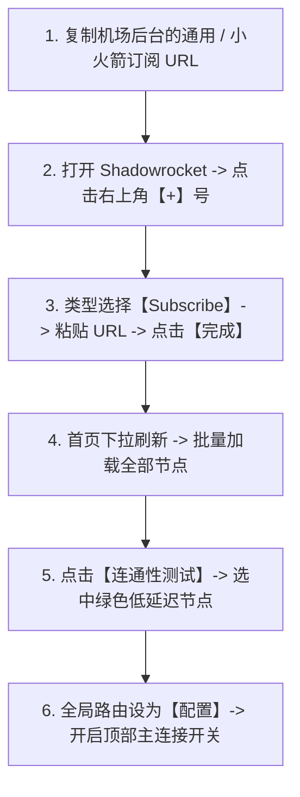

# iOS Shadowrocket (小火箭) 安装与订阅配置完整实战教程 (2026 最新)

<QuickAnswer>
<strong>核心结论：</strong>在苹果 iOS 设备（iPhone/iPad）上配置代理的最佳工具是 <strong>Shadowrocket（小火箭）</strong>。标准上手四步法：<strong>① 在 App Store 中登录海外 Apple ID 下载正版小火箭；② 打开小火箭点击右上角【+】号，类型选【Subscribe】，粘贴订阅链接并完成保存；③ 首页下拉刷新拉取节点，点击【连通性测试】选择低延迟节点；④ 全局路由保持【配置 (Config)】，打开顶部主连接开关</strong>即可畅享海外网络。
</QuickAnswer>

## 一、Shadowrocket（小火箭）官方正规获取指南

由于地区政策原因，Shadowrocket 仅在**中国大陆以外的 App Store** 上架（售价 $2.99 美元）。

### 1. 安全正规的下载步骤
1. **准备一个海外 Apple ID**（美区、港区或日区均可，可自行通过苹果官网免费注册）。
2. 打开 iPhone 上的 **App Store**，点击右上角个人头像拉到最底部，点击 **“退出登录 (Sign Out)”**。
3. 在 App Store 重新登录您的海外 Apple ID（**切勿在 iPhone 系统“设置”中登录 iCloud，仅在 App Store 登录！**）。
4. 购买正规 App Store 礼品卡充值后，在商店搜索 `Shadowrocket`（开发者为 *Shadow Launch Technology Limited*，图标为一个白色四翼小火箭背景为深蓝色）并完成购买下载。
5. 下载完成后，在 App Store 退出海外账号，换回您的日常主力 Apple ID 即可（已下载的应用不受任何影响）。

---

## 二、订阅添加与一键连接保姆级实操

### 步骤 1：添加订阅链接
1. 登录您的机场服务后台（如光速云），找到小火箭专属订阅或通用订阅链接，点击复制。
2. 打开 Shadowrocket 客户端，点击主界面右上角的 **`+`** 按钮。
3. 点击第一项 **“类型 (Type)”**，将其从默认的 Shadowsocks 改选为 **`Subscribe (订阅)`**。
4. 在 **“URL”** 一栏中长按并粘贴刚才复制的订阅链接，在“备注”中输入 `光速云专线`。
5. 点击右上角的 **“完成 (Done)”** 保存。

### 步骤 2：下拉更新与连通性测试
1. 回到小火箭首页，用手指在屏幕中间向下拉动并松开，客户端将自动连接服务器拉取最新的节点列表。
2. 点击列表中部的 **“连通性测试 (Connectivity Test)”**。
3. 各节点右侧会快速刷新出延迟毫秒数，选择显示为绿色低延迟的节点（如 `香港 01` 或 `日本 01`）。

### 步骤 3：选择路由模式并开启连接
1. 在首页中部的 **“全局路由”** 中，确保选择为 **`配置 (Config)`**（此模式下国内 App 走本地直连，海外 App 走代理）。
2. 拨动最顶部的 **主开关**。
3. 首次开启时，iOS 系统会弹窗提示“Shadowrocket 想要添加 VPN 配置”，点击 **“允许 (Allow)”**，并输入您的 iPhone 锁屏密码即可完成授权连接。

---

## 三、进阶技巧：设置定时自动更新订阅与分流规则

为了保证每天使用的节点都是最新可用的，建议开启自动更新：

1. 点击小火箭底部菜单栏的 **“设置 (Settings)”**。
2. 点击 **“订阅 (Subscribe)”** 选项。
3. 勾选并开启 **“打开时更新 (Update on Open)”** 以及 **“自动后台更新 (Auto Update)”**。
4. 这样每次启动小火箭时，软件都会在后台静默同步最新的服务器节点，省去手动刷新的麻烦。

---

## 四、常见故障排查决策树

<TroubleshootingBox
  title="小火箭使用常见问题与解决办法"
  :steps="[
    {
      symptom: '点击开启连接后，小火箭开关瞬间自动弹回并关闭',
      solution: '通常是由于 iOS 系统的 VPN 描述文件损坏。请前往 iPhone【设置】->【通用】->【VPN与设备管理】-> 找到 Shadowrocket 配置并删除，重新打开小火箭开启连接并重新允许授权即可。'
    },
    {
      symptom: '开启后微信、淘宝等国内 App 刷新变慢或提示网络异常',
      solution: '请检查首页中部的全局路由是否被误选为了【代理 (Proxy)】模式。请立即切换回【配置 (Config)】模式。'
    },
    {
      symptom: '连上节点后可以看 YouTube，但打开 TikTok 却黑屏不加载视频',
      solution: 'TikTok 对中国大陆 SIM 卡和地区语言有额外检测机制。建议在小火箭中使用美区或日区纯净原生节点，并在设置中开启 HTTPS 解密或使用专门针对 TikTok 的分流规则模块。'
    }
  ]"
/>

---

## 五、新手常见问答 (FAQ)

<FaqAccordion :items="[
  {
    q: '使用小火箭会影响 iPhone 接收国内微信或外卖推送吗？',
    a: '完全不会。在【配置 (Config)】模式下，苹果 APNs 推送服务和国内主流应用全部走本地宽带直连通道，消息推送依然是毫秒级实时到达。'
  },
  {
    q: '小火箭如何将节点分享给同一 Wi-Fi 下的 iPad 或电脑？',
    a: '点击底部【设置】->【代理】-> 开启“共享代理 (Proxy Share)”，记录显示的 IP 和端口（默认 1082）。在 iPad 或电脑的 Wi-Fi 代理设置中填入该参数即可。'
  },
  {
    q: '更换了新 iPhone 后，小火箭还需要重新付费购买吗？',
    a: '不需要！只要在 App Store 中登录当初购买过小火箭的同一个海外 Apple ID，即可直接在“已购项目”中免费下载安装。'
  }
]" />

---

## 六、下一步探索

<TopicBridge
  title="想要拥有全天候高速、免频繁更新的专线订阅？"
  targetLink="/free-airport/recommendations"
  targetText="查看《2026 稳定新手机场实测推荐》"
>
  小火箭完美支持光速云的一键导入功能。享受全专线极速网络、原生解锁 TikTok、Instagram、YouTube 与 ChatGPT。
</TopicBridge>

<BrandCard
  brandName="光速云 (Guangshu Cloud)"
  description="深度适配 iOS Shadowrocket (小火箭)。支持在手机后台一键直接唤起小火箭完成订阅导入，全 IEPL BGP 专线保障，秒开海外 App，支持月付体验与售后退款。"
  affLink="https://sahude.gsyvipaff.com/#/?code=keqgvT5Y"
/>
