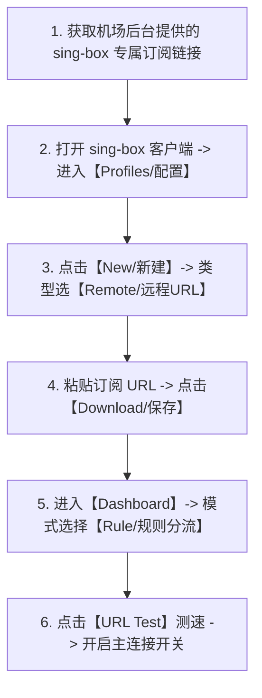

# sing-box 通用客户端从零安装、订阅配置与高级分流实战教程 (2026 最新)

<QuickAnswer>
<strong>核心结论：</strong><strong>sing-box</strong> 是目前开源社区性能最强悍、资源占用最低的新一代通用代理平台。配置标准流程：<strong>① 下载对应平台的图形客户端（Windows/Mac 推荐 GUI.for.SingBox 或 SFA/SFM；iOS 直接在 App Store 免费下载官方版）；② 在【Profiles / 订阅】中粘贴 sing-box 专属 JSON 订阅 URL；③ 启用配置并在节点面板中选择低延迟节点；④ 开启【TUN 虚拟网卡模式】或系统代理</strong>。其最大的技术优势在于原生完美支持 <strong>Hysteria 2、VLESS-Reality、TUIC 及 ShadowTLS</strong> 等下一代抗封锁协议。
</QuickAnswer>

## 一、为什么 sing-box 成为下一代代理平台的绝对主流？

随着网络封锁技术的升级与多协议生态的演进，传统的单一代理内核逐渐显露疲态。由 SagerNet 团队开源的 **[sing-box](https://github.com/SagerNet/sing-box)** 凭借以下核心优势迅速成为行业标杆：

```text
┌─────────────────────────────────────────────────────────────┐
│                 【sing-box 新一代全能核心】                   │
├──────────────────────────────┬──────────────────────────────┤
│ 1. 内存与 CPU 占用极低       │ 资源占用仅为传统内核的 1/4   │
│ 2. 原生全协议大满贯支持      │ Hysteria2, VLESS, TUIC, SS   │
│ 3. 跨平台统一内核与配置规范  │ Windows, macOS, iOS, Android │
│ 4. 原生高性能 TUN 网卡驱动   │ 无缝接管终端、容器与游戏流量 │
└──────────────────────────────┴──────────────────────────────┘
```

1. **极致性能**：采用现代化 Go 语言优化架构，内存占用低至十几兆字节，在低功耗轻薄本与移动设备上续航表现极其优秀。
2. **协议大满贯**：原生支持基于 UDP 协议的 **Hysteria 2** 与 **TUIC v5**，在恶劣丢包网络（如移动 4G/5G 或校园网）下依然能跑满带宽。

---

## 二、全平台客户端获取与安装指南

<ComparisonTable
  :headers="['操作系统平台', '推荐图形客户端 (GUI)', '下载与获取渠道', '特点说明']"
  :rows="[
    ['Windows (10/11)', 'GUI.for.SingBox / Sing-box for Windows', 'GitHub 官方 Releases 仓库', '图形化操作直观，支持一键切换 TUN 网卡模式'],
    ['macOS (Apple M系列/Intel)', 'sing-box for macOS (SFM) / GUI', 'Mac App Store / GitHub Releases', '原生集成 macOS 系统网络扩展，性能优异'],
    ['iOS / iPadOS', 'sing-box (官方版)', '海外 App Store 官方商店 (免费应用)', '官方正版客户端，支持后台静默长连接与分流'],
    ['Android (安卓手机/平板)', 'Sing-box for Android (SFA)', 'Google Play / GitHub Releases', '开源免授权，支持应用分应用独立代理']
  ]"
/>

---

## 三、sing-box 导入订阅与日常使用图解步骤



### 步骤 1：获取专属订阅
登录机场后台（如光速云），找到并复制 **sing-box 专属订阅链接**（如果机场暂未提供独立的 sing-box 选项，可使用本站提供的《订阅转换工具》将通用 Clash/V2Ray 链接转换为 sing-box 格式）。

### 步骤 2：在客户端中拉取配置
1. 打开 sing-box 客户端，点击导航栏的 **“Profiles (配置)”**。
2. 点击右上角的 **“+”** 或 **“New”** 新建配置。
3. 在 Name 输入备注（如 `光速云专线`），在 URL 栏粘贴刚才复制的链接，点击 **“Download / Save”** 保存。
4. 勾选激活该配置。

### 步骤 3：测速并开启连接
1. 进入客户端首页 **“Dashboard / 控制台”**。
2. 模式选择推荐的 **“Rule (规则模式)”**。
3. 点击节点分组中的测速按钮，选择延迟在 20ms~50ms 左右的可用专线节点。
4. 点击开启最顶部的 **“Connect / 启动连接”** 开关即可畅享高速网络。

---

## 四、常见故障排查决策树

<TroubleshootingBox
  title="sing-box 常见运行问题排查"
  :steps="[
    {
      symptom: '导入订阅时提示“parse config error: unknown field”',
      solution: '这是由于客户端核心版本与订阅配置的语法规范不兼容。请前往 GitHub 检查并将 sing-box 客户端升级至最新的正式版本（v1.9+）。'
    },
    {
      symptom: '开启 TUN 模式后提示“create tun interface failed: permission denied”',
      solution: 'TUN 虚拟网卡需要管理员底层权限。在 Windows 上右键点击客户端选择【以管理员身份运行】；在 Mac 上前往系统【隐私与安全性】允许系统扩展即可。'
    },
    {
      symptom: '使用 Hysteria 2 节点时提示“UDP socket error: buffer overflow”',
      solution: '这是由于本地宽带路由器开启了较为激进的 UDP 丢包限制。可在配置中调小 Hysteria 2 节点的标称上行/下行速率参数（如限制为 100Mbps）。'
    }
  ]"
/>

---

## 五、新手常见问答 (FAQ)

<FaqAccordion :items="[
  {
    q: 'sing-box 相比 Clash 有什么核心优势？',
    a: 'sing-box 的核心优势在于原生支持最新的 Hysteria 2 和 VLESS-Reality 协议，在恶劣弱网环境下的抗丢包加速能力明显强于传统 Clash 内核，且内存占用极低。'
  },
  {
    q: 'iOS 上的官方 sing-box 是免费的吗？',
    a: '是的！与收费的 Shadowrocket (小火箭) 不同，sing-box 在海外 App Store 是一款完全开源免费的应用，无需付费购买即可直接下载使用。'
  },
  {
    q: '为什么 sing-box 的配置文件是 .json 格式而不是 .yaml？',
    a: 'sing-box 采用结构化极其严密的标准 JSON 语法设计，解析速度比 YAML 快数倍，大幅降低了大型规则集的解析与内存占用开销。'
  }
]" />

---

## 六、下一步探索

<TopicBridge
  title="需要支持 Hysteria 2 与 VLESS 的高质量专线订阅？"
  targetLink="/free-airport/recommendations"
  targetText="查看《2026 稳定新手机场实测推荐》"
>
  光速云全系节点全面适配 sing-box 客户端，提供原生 Hysteria 2 与 BGP IEPL 专线，享受超低延迟与秒开体验。
</TopicBridge>

<BrandCard
  brandName="光速云 (Guangshu Cloud)"
  description="深度适配 sing-box 全平台客户端。提供标准专属 JSON 订阅源，支持 Hysteria 2 与 IEPL 专线协议，原生纯净 IP 赋能 AI 与高清影视，支持月付体验。"
  affLink="https://sahude.gsyvipaff.com/#/?code=keqgvT5Y"
/>
