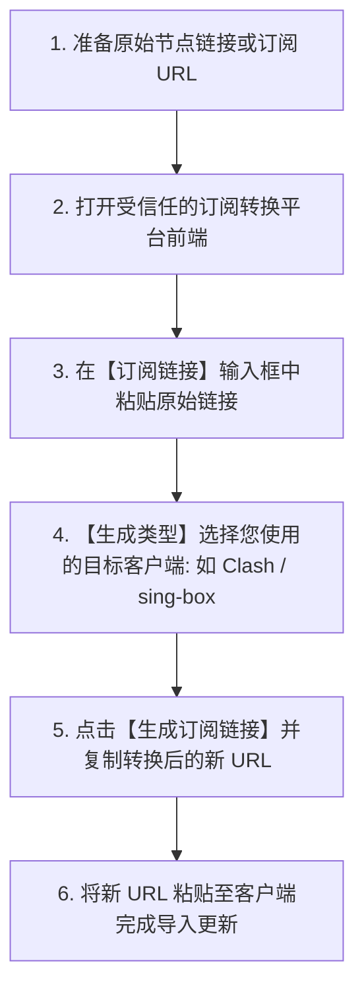

# 订阅链接转换教程与格式解析：Clash / v2rayN / 小火箭 / sing-box (2026 最新)

<QuickAnswer>
<strong>核心结论：</strong><strong>订阅转换（Subconverter）</strong>的作用是将不同格式的节点数据（如单条 <code>vmess://</code>、<code>ss://</code> 链接或 Base64 文本）自动解析并重组为特定客户端所要求的配置文件（如 Clash 的 YAML、sing-box 的 JSON 或 Quantumult X 规则）。使用公开订阅转换网站时，<strong>切勿转换包含重要敏感信息或大额年费的高价值私有订阅</strong>（防止订阅 Token 被恶意后端记录盗刷）；若机场已提供对应客户端的一键专属订阅，<strong>强烈建议直接使用原生订阅，无需二次转换</strong>。
</QuickAnswer>

## 一、为什么需要进行“订阅转换”？

在代理技术发展史上，不同开源客户端制定了各自独立的配置文件语法标准：

```text
┌─────────────────────────────────────────────────────────────┐
│                 【输入：原始节点与订阅源】                    │
│   单节点: ss://, vmess://, vless:// 或 Base64 编码纯文本     │
└──────────────────────────────┬──────────────────────────────┘
                               │ 经由 Subconverter 转换引擎
                               ▼
  ┌─────────────────┬─────────────────┬─────────────────┐
  │   Clash 格式    │   sing-box 格式 │   小火箭/Surge  │
  │ (.yaml 规则集)  │ (.json 结构体)  │ (.conf 配置文件)│
  └─────────────────┴─────────────────┴─────────────────┘
```

- **Clash 系列**：强制要求使用包含 `proxies`、`proxy-groups`、`rules` 三大模块的标准 **YAML** 文件。
- **sing-box 系列**：强制要求使用标准 **JSON** 格式。
- **Shadowrocket (小火箭) / v2rayN**：对纯文本 Base64 编码的节点列表支持极好，但对高级规则分流支持各有差异。

当您从某些开源社区获取到一组零散的 `vmess://` 或 `ss://` 链接，想要在 Clash 或 sing-box 中导入使用时，**订阅转换工具就是沟通二者的桥梁**。

---

## 二、在线订阅转换标准操作指南



### 步骤 1：准备原始链接
将需要转换的多行节点链接（如以 `ss://`、`vmess://`、`vless://`、`trojan://` 开头的文本）或者已有的 Base64 订阅地址完整复制到剪贴板。

### 步骤 2：选择转换参数
打开开源受信任的订阅转换前端界面（如各大开源托管的 Subconverter 前端）：
1. **订阅链接 (Subscription URL)**：长按粘贴刚才准备的链接。
2. **生成类型 (Client Type)**：根据您使用的客户端选择：
   - 使用 Clash Verge / Clash for Windows → 选择 **`Clash`** 或 **`Clash.Meta`**。
   - 使用 sing-box 客户端 → 选择 **`sing-box`**。
   - 使用 Surge 客户端 → 选择 **`Surge 4`**。
3. **远程配置 (Remote Config)**：建议选择 **`基础分流规则 (ACL4SSR / 经典轻量版)`**，系统将自动注入常用国内直连与海外代理的分流规则。
4. **生成新订阅**：点击 **“生成订阅链接”**，系统将输出一串由后端服务实时解析生成的新 URL。

### 步骤 3：导入客户端
复制生成好的新订阅链接，前往 Clash Verge Rev 的【订阅】或 sing-box 的【Profiles】页面粘贴并导入即可。

---

## 三、使用第三方订阅转换的安全防范清单

<TroubleshootingBox
  title="订阅转换三大安全避坑要点"
  :steps="[
    {
      symptom: '使用不知名小网站转换后，机场流量在数天内异常归零（被盗刷）',
      solution: '部分非正规搭建的公开转换网站会在后端数据库中记录所有转换过的 Token 链接并共享给爬虫。切勿将重要的付费主力订阅填入来历不明的转换网站！'
    },
    {
      symptom: '转换后的订阅在 Clash 中导入报错“Invalid YAML format”',
      solution: '这是由于原始节点中包含了不支持的特殊符号或转换后端服务临时宕机。请尝试切换其他公共转换后端接口（如 sub.xeton.dev 或自建后端）。'
    },
    {
      symptom: '原生机场订阅本身很稳定，是否还需要进行订阅转换？',
      solution: '完全不需要！正规机场（如光速云）已经内置了企业级原生分流规则与全格式支持，直接复制专属订阅导入即可，二次转换反而会降低更新速度并增加故障率。'
    }
  ]"
/>

---

## 四、新手常见问答 (FAQ)

<FaqAccordion :items="[
  {
    q: '什么是自建 Subconverter 后端？普通用户有必要自建吗？',
    a: '自建 Subconverter 指将开源转换程序部署在自己的 VPS 或家庭 NAS/软路由上，所有转换请求仅在自己的私有服务器处理，100% 避免 Token 泄露。对于普通用户，只要选择正规提供全协议订阅的机场，通常无需自建。'
  },
  {
    q: '为什么有些订阅链接转换后，部分节点丢失了？',
    a: '如果原始节点使用了非常新的特种协议（如 Hysteria 2、TUIC、VLESS-Reality），而该转换后端的 Subconverter 版本过旧无法识别，就会自动过滤掉这些无法解析的节点。请确保转换后端升级到了支持 Meta/sing-box 内核的最新版本。'
  },
  {
    q: '“短链接 (Short URL)”功能可以随便使用吗？',
    a: '短链接只是为了方便在电视等设备上输入而将长 URL 缩短。但在公开平台上生成的短链接可能被全网遍历扫码，建议仅在私有可信的短链服务中生成。'
  }
]" />

---

## 五、下一步探索

<TopicBridge
  title="无需繁琐转换，直接获取全格式原生支持的专线订阅？"
  targetLink="/free-airport/recommendations"
  targetText="查看《2026 稳定新手机场实测推荐》"
>
  光速云原生提供标准 Clash YAML、sing-box JSON、小火箭与 v2rayN 专属一键订阅，免除一切格式转换风险，即开即用。
</TopicBridge>

<BrandCard
  brandName="光速云 (Guangshu Cloud)"
  description="全格式原生支持：用户中心一键直达 Clash、Shadowrocket、v2rayN 与 sing-box，无需二次转换。全 IEPL 跨境专线，原生纯净 IP，支持月付体验。"
  affLink="https://sahude.gsyvipaff.com/#/?code=keqgvT5Y"
/>
